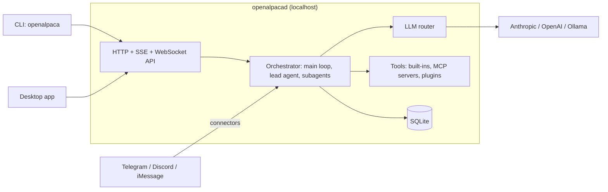

# OpenAlpaca

OpenAlpaca is a personal AI agent that runs on your own machine.
One background daemon does the work; a command-line tool and a desktop app talk to it.
It runs on a local Ollama model with no API key, or on Anthropic and OpenAI models with a key.

**Status:** version 0.1.0, a personal project under active development. The core paths work. Interfaces, config and the database schema still change. See [Status and limitations](#status-and-limitations).

## What you can do with it

- **Chat** from a terminal or the desktop app. Replies stream as they are written.
- **Use a local model.** A local Ollama needs no API key and costs nothing.
- **Hand off bigger jobs.** Ask for a workflow: a lead agent runs it in the background with subagents, then reports back in the chat.
- **Steer work in flight.** Check, pause, resume, cancel or redirect a running workflow from the same conversation.
- **Work in your project.** In a project an agent reads, lists, writes and edits its files and runs commands there. Each write and each command asks you first, and what it writes is a real file of the project. Drafts and hand-offs are kept as versioned artifacts.
- **Attach files** to a message.
- **Keep a memory.** What you ask it to remember, and what it learns from what you say, are Markdown notes on your own disk — searched by keyword, with no model or download, and readable, editable and forgettable in the app, the CLI or any text editor.
- **Add tools** with skills (markdown files), MCP servers and plugins. Each extension has an on/off switch.
- **Reach it from chat apps:** Telegram, Discord, and iMessage on macOS.

## Quick start

These steps build from source and end with a first reply. To package and install a release instead, read [docs/QuickStart_Manual.md](docs/QuickStart_Manual.md).

### 1. Prerequisites

- **Rust** through [rustup](https://rustup.rs). The repo pins 1.99.1 in `rust-toolchain.toml`; rustup fetches it on the first build.
- **A model:** [Ollama](https://ollama.com) running locally, or an Anthropic or OpenAI API key.
- **[Bun](https://bun.sh)** 1.4.3 (the version the root `package.json` pins), only for the desktop app (step 6).
- Linux only: `sudo apt-get install -y pkg-config`. The desktop app also needs `libdbus-1-dev` and [Tauri's system libraries](https://tauri.app/start/prerequisites/).

### 2. Build

```bash
git clone https://github.com/tangyunpei/OpenAlpaca.git
cd OpenAlpaca
cargo build -p openalpacad -p openalpaca
export PATH="$PWD/target/debug:$PATH"
```

This builds the daemon (`openalpacad`) and the CLI (`openalpaca`). The `export` lets this terminal find them.
Check it: `openalpaca --help` lists the commands.

### 3. Start the daemon

```bash
openalpaca daemon start --daemon-only
openalpaca daemon status
```

`start` prints the path of the daemon log and returns at once. `status` prints `✓ Daemon is running` once the daemon answers. If it says the daemon is not running, run it again a second later.

The first start downloads nothing and takes a few seconds. To watch it, open a second terminal and run `tail -f ~/.openalpaca/state/logs/daemon.log`; the line `Daemon ready` means it is up. Wait for it before step 4.

The first start also creates `~/.openalpaca/`. A daemon started this way reads its config from `~/.openalpaca/config/`, not from the repo's `config/`.

### 4. Pick a model

Every provider starts switched off. Turn one on. The running daemon picks the change up; no restart is needed.

**Option A: a local Ollama, no API key**

```bash
openalpaca config set ai.ollama.enabled true
ollama pull qwen3:8b                          # an example; any chat model works, tool-capable ones work best
openalpaca llm models --refresh               # lists what your Ollama has installed
```

**Option B: an API key**

```bash
openalpaca config set ai.anthropic.enabled true   # or: ai.openai.enabled
openalpaca llm keys add --provider anthropic      # or: openai
```

Keep this order: switch the provider on, then add the key. `keys add` asks for the key (hidden input), a source label and optional notes. The key is stored encrypted.

Check the result with `openalpaca llm status`. The seeded default model is a Claude id. When that model is not available, the router uses one that is, and the status output names it.

### 5. Send a first message

```bash
openalpaca chat --message "Hello, what can you do?"
openalpaca chat                               # interactive; type exit to leave
```

The reply streams into the terminal. With no provider switched on, the turn fails with an error that tells you to turn one on.

On a fresh install the assistant opens with a short getting-to-know-you conversation and cannot start workflows yet. It ends by itself once it has filled in your profile and its own identity. To skip it, delete `~/.openalpaca/config/orchestrator/BOOTSTRAP.md`. The next daemon start puts the file back until both are filled in.

### 6. Open the desktop app

```bash
cd apps/openalpaca-gui
bun install
bun run tauri dev
```

The first run compiles the app shell, so give it a few minutes. The app connects to the daemon you already started. If none is running, it starts one itself.

To stop the daemon: `openalpaca daemon stop`.

## How it works

One process, `openalpacad`, owns everything: the database, the agents, the model router and the tools. It listens on a random localhost port and writes the port and a bearer token to `~/.openalpaca/state/discovery.json`. The CLI and the desktop app read that file to connect, so they need no setup.



The path of one message:

1. Slash commands are routed without asking a model: `/status`, `/tasks`, `/cancel`, `/pause`, `/resume`, `/steer <text>`, and `/<skill>` to run a skill.
2. Everything else goes to the main loop. The model answers directly, or calls a tool: start a workflow, steer a running one, queue a follow-up, check a task, or store and search memory. A tool that needs confirmation pauses until you approve it.
3. A workflow runs in the background. A lead agent spawns subagents (up to eight per batch), waits for them, and posts a completion report to the chat.
4. The LLM router picks a provider and key for each call. If the requested model is not available, it falls back to one that is and says so.
5. Replies stream to the client over SSE. Task, agent and tool events stream over WebSocket. Conversations and tasks are stored in SQLite; memory is Markdown files, with a disposable SQLite keyword index beside them.

More detail: [docs/agent-loop.md](docs/agent-loop.md) and [docs/Daemon_Manual.md](docs/Daemon_Manual.md).

## Project layout

A Rust workspace (edition 2024) with three apps and eight library crates.

| Path | What it is |
|---|---|
| `apps/openalpacad` | The daemon: HTTP, SSE and WebSocket API, and every service behind it |
| `apps/openalpaca` | The CLI: daemon lifecycle, chat, tasks, models and keys, extensions, config |
| `apps/openalpaca-gui` | The desktop app: Tauri v2 shell, React 19 + TypeScript + Tailwind v4 frontend |
| `crates/openalpaca_core` | Orchestrator, message routing, agent loop, tools, skills, security gate, event bus |
| `crates/openalpaca_llm` | LLM router, providers, key pools, rate limiting, cost tracking |
| `crates/openalpaca_storage` | SQLite, migrations, repositories, the memory note files and their search index, the `~/.openalpaca` store, artifacts, uploads |
| `crates/openalpaca_api` | Shared event types and plugin executor traits |
| `crates/openalpaca_wake` | Cron scheduler and file watcher (scheduled skills, config hot reload) |
| `crates/openalpaca_connectors` | Telegram, iMessage and Discord adapters |
| `crates/openalpaca_mcp` | MCP client: stdio and streamable-HTTP transports |
| `crates/openalpaca_plugins` | Out-of-process plugins: JSON-RPC over stdio, manifests, approval gate |

## Configuration and data

Config is plain files. The daemon reloads most of them when they change. Edit them by hand, with `openalpaca config`, or in the app's Settings.

| File | Purpose |
|---|---|
| `llm.toml` | Providers, keys (encrypted), default model, fallback chains. Created on first start; git-ignored in the repo. |
| `daemon.toml` | Execution limits, cost caps, routing, sessions, uploads, security, server settings. The repo's `config/daemon.toml` is the full reference; a fresh install gets a shorter file and built-in defaults. |
| `mcp.toml` | MCP server declarations and each server's on/off switch. |
| `agents/*.md` | Agent templates: YAML frontmatter (model, capabilities, limits) plus a persona. Nine ship. |
| `skills/*/SKILL.md` | Skills. Four ship: `code-review`, `commit-message`, `create-skill`, `explain-code`. |
| `orchestrator/*.md` | The assistant's persona documents (`SOUL.md`, `USER.md`, `IDENTITY.md`), created on first start. `USER.md` is yours to edit (`openalpaca persona edit user`, or Settings → Persona); nothing writes learned facts into it. |

Which directory holds them:

- Started by the CLI or the desktop app: `~/.openalpaca/config/`. The first start fills it with defaults.
- Started by hand (`cargo run -p openalpacad`): the directory `OPENALPACA_CONFIG_DIR` names, when it exists. Otherwise the daemon searches upward for a `config/llm.toml`, then falls back to `./config`.

Data always lives under `~/.openalpaca/`, on every platform:

| Path | Holds |
|---|---|
| `state/` | The database, `discovery.json`, the lock, the master key, logs, backups, the memory control snapshots and the memory search index |
| `config/`, `plugins/` | Runtime config and installed plugins |
| `artifacts/`, `uploads/`, `sessions/` | By-products agents saved with no project, what you attached, and conversation logs |
| `scratch/` | One working folder per conversation with no project, removed with the conversation |
| `memory/` | Memory notes, one Markdown file each, per owner |
| `projects/` | One folder per project — a git repository you chat in, or a folder you chose — with its `project.json`, artifacts, uploads and memory notes |

Set `OPENALPACA_HOME_STORE=/absolute/path` to move the whole root, for example to try things in a sandbox. A project's files and notes live in its folder under `projects/`, named after its path. Nothing OpenAlpaca stores is written inside the project's own folder: an agent writes there only with your approval, each write and each command asking first (Daemon Manual → *The Working Folder*).

## Documentation

| Document | Read it when |
|---|---|
| [docs/QuickStart_Manual.md](docs/QuickStart_Manual.md) | You want to package and install a release rather than build from source |
| [docs/Installation_Manual.md](docs/Installation_Manual.md) | You need install details, local-model setup, upgrades, or troubleshooting |
| [docs/CLI_Manual.md](docs/CLI_Manual.md) | You use the `openalpaca` command |
| [docs/GUI_Manual.md](docs/GUI_Manual.md) | You use the desktop app |
| [docs/Daemon_Manual.md](docs/Daemon_Manual.md) | You run or configure the daemon, or call its API |
| [docs/agent-loop.md](docs/agent-loop.md) | You want to know how a turn, a workflow and steering work |
| [docs/Skill_Template_Reference.md](docs/Skill_Template_Reference.md) | You write a skill |
| [docs/tools/DESIGN.md](docs/tools/DESIGN.md), [TECHNICAL.md](docs/tools/TECHNICAL.md) | You work on the tool system |
| [apps/openalpaca-gui/README.md](apps/openalpaca-gui/README.md) | You work on the desktop app |
| [docs/api/README.md](docs/api/README.md) | You need the generated API and schema reference |

## Development

```bash
cargo build -p openalpacad -p openalpaca                      # the daemon and the CLI
cargo build --workspace --exclude openalpaca_gui              # everything but the desktop shell, as CI builds it
cargo test --workspace --exclude openalpaca_gui               # all Rust tests, as CI runs them
cargo clippy --workspace --exclude openalpaca_gui --all-targets

cd apps/openalpaca-gui && bun install
bun run check && bun run test && bun run format:check && bun run build
```

- A bare `cargo build` or `cargo test` covers what `--workspace --exclude openalpaca_gui` does: `default-members` is every member but the desktop shell, both apps included. Check the shell in its own `target/gui`, as [apps/openalpaca-gui/README.md](apps/openalpaca-gui/README.md) says.
- CI (`.github/workflows/ci.yml`) has four jobs: the Rust build, tests and clippy above, run `--locked` on the toolchain `rust-toolchain.toml` pins; the four `bun run` gates under the Bun the root `package.json` pins; the Windows install-script tests on Pester 6.2.0; and a tooling job — the scripts' tests, `gen_api_docs.py --check` and the repository-policy guard `scripts/repo_policy.py` — on Python 3.9.25, the scripts' floor. Its actions are pinned by commit SHA.
- Advisories (`.github/workflows/audit.yml`), on every pull request, every push to `main` and weekly: cargo-deny checks the crates the workspace resolves to (not every `Cargo.lock` entry) against RustSec, the licence allow list and crates.io as the only source (`deny.toml`); cargo-audit, run by hand from the root, reads the whole lock with the same ignores (`.cargo/audit.toml`); and `bun audit` checks `bun.lock`. The owner answers a red run: a lock refresh, a bump, or an ignore with its reason.
- To run the daemon in the foreground on the repo's own config, use `OPENALPACA_CONFIG_DIR="$PWD/config" cargo run -p openalpacad`. Export the same variable for the CLI, so `openalpaca config set` edits the same files.
- `docs/api/` is generated. Run `python3 scripts/gen_api_docs.py`; never edit it by hand.
- Toolchain: Rust 1.99.1. Frontend: Bun 1.4.3, TypeScript 7, React 19, Vite 8, Tailwind 4, Vitest 5.

## Status and limitations

- **Moving target.** Config keys, API routes and the database schema change between commits. `001_baseline.sql` initializes schema version 1, `002_working_state.sql` upgrades it to 2, `003_no_project_store_rows.sql` to 3 and `004_project_files.sql` to 4, so a fresh database opens at 4, and the next migration will be `005`. A database from before that re-baseline (2026-09-28) — 42, the last schema with memory inside the database, or 43 to 45 — is refused rather than upgraded; see [Switching to the Markdown Memory Build](docs/Installation_Manual.md#switching-to-the-markdown-memory-build).
- **The shell is not confined to the project.** A command an agent runs starts in the project's folder, but an approved command runs as you and can reach any file you can. Every command asks first: read it before you approve it.
- **Reading never asks.** In a project an agent can read any file there, `.env` included, and what it reads goes to the model that answers — a remote provider's when that model is not local.
- **Platforms.** Developed on macOS. CI builds and tests on Linux. Windows has packaging scripts, but CI does not build the Rust workspace there.
- **Plugins** can add tools, skills and agent templates. Plugin connectors and plugin LLM providers are declared in the manifest format but not wired. They do not work.
- **MCP** is client-side and tools only. MCP resources and prompts are not implemented: the client has no resource or prompt methods. Serving MCP is not a goal.
- **Memory search is by keyword.** There is no embedding model, so a question worded very differently from the note, or in another language, can miss it. Aliases on a note (for example a Chinese and an English name for the same thing) are the remedy.
- **Desktop app.** Two controls are shown as unavailable because the daemon has no route for them: adding a connector, and the per-agent-template on/off switch.
- **Resuming an interrupted run** by replay is experimental and off by default (`resume_enabled` in `daemon.toml`).
- **Costs.** A chat turn is capped at $1. A workflow's lead agent is capped at $3 by its shipped template (`daemon.toml` defaults to $5 where a template sets nothing). There is no overall daily budget; only the small background jobs (memory extraction, summaries, task-output extraction) have daily ceilings.
- **Releases are unsigned.** The macOS package is not code-signed.
- **License:** MIT, as declared in `Cargo.toml`.
