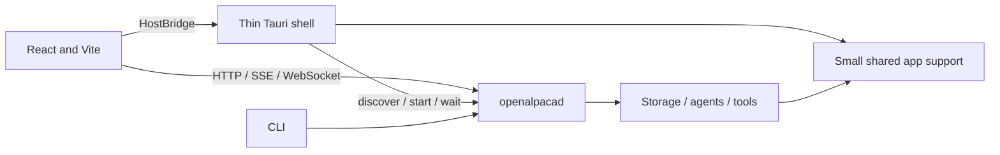

# Dependency upgrade audit — 2026-10-10

**Rev 2.1 needs another revision before execution. Keep React + Vite and adopt a thinner Tauri 2 shell around the existing Rust daemon.** The dependency work remains worthwhile, but the archived patches, storage rehearsal and GUI acceptance criteria no longer describe the current application. Treat the GUI architecture and performance changes as separately reviewable work with their own baselines.

This companion audits application commit **`7295f91beb6832204092f98ddc688578321eb0a0`**, branch `feat/markdown-memory`, against the original [plan](/Users/tangyunpei/dev/OpenAlpaca/tasks/deps-upgrade/plan.md), its 11 reports and archived evidence. It also incorporates the earlier chat recommendations for low memory use, fast startup, easy React editing and fast compilation. These are recommendations; no implementation or dependency upgrade was performed.

The original plan, reports, archive and October 8/9 audits are preserved. The evidence archive matches the previously extracted copy at `/private/tmp/openalpaca-deps-audit-_gj26hpv/evidence`, outside the repository. Fresh evidence is in [this audit directory](/private/tmp/openalpaca-deps-audit-20261010-s048cwp0). Temporary evidence may later be cleaned; the findings and acceptance criteria are retained here.

## What changed since the previous audit

The application is **180 commits / 216 changed tracked files** beyond the October 9 audit's `d484a56a`, and **651 commits / 605 files** beyond rev 2's checked tip `908050f1`. Nine of the combined patch's 37 paths overlap current changes. The dependency wave has still not landed: the lock retains rusqlite 0.38.0, sha2 0.10.9, aes-gcm 0.10.3, keyring 3.6.3, rmcp 0.16.0 and Tauri 2.11.5; Rust remains pinned to 1.93.0.

Today's storage Stage 2 changes matter directly: database schema 4 adds real-project file pointers; tool permissions distinguish project writes from app-owned by-products; native Reveal now admits files under registered, present projects. These changes affect migration patches, rollback builds, isolation and the proposed thin-shell boundary.

| Fresh check | Result and limit |
|---|---|
| `git apply --check` for `combined.diff` | Fails in `Cargo.lock`, core `tools/builtins/mod.rs`, storage `database/tests.rs` and `store/tests.rs`. Nothing applied. The builtins conflict is new. |
| Individual patches, excluding lock hunks | Documents, web, config, storage, toolchain, GUI-final and CI patches pass applicability checks. MCP and secrets fail. Passing means textual applicability only. |
| Current AES module patch alone | Applies to the encryption module/tests. No fresh crypto runtime test. |
| Current frontend in an isolated tracked-source export | Type checks, tests, formatting and production asset build pass: **121 test files, 1,551 tests**. Existing installed modules were cloned; no dependency install. |
| Frontend environment | Bun 1.3.13, Node 24.15.0, React 19.2.8, Vite 7.3.6, Vitest 4.1.11, TypeScript 7.0.2. This is the current dependency baseline, not the proposed upgraded set. |
| Locked/offline GUI dependency graph | Confirms GUI → storage → rusqlite 0.38.0 → libsqlite3-sys 0.36.0. No native build performed. |
| Upstream checks | Tauri releases/advisory, Rust 1.99.0, Dependabot Bun support, and two previously identified RustSec vulnerabilities rechecked against official sources. Not a complete release/advisory census. |

The build emits 19 JavaScript chunks totaling 740,645 bytes and 48,427 bytes CSS. Those are asset sizes, not memory measurements. Detailed results: [patch/version inventory](/private/tmp/openalpaca-deps-audit-20261010-s048cwp0/current-audit-checks.json), [frontend gates](/private/tmp/openalpaca-deps-audit-20261010-s048cwp0/gui-baseline-results.json), [asset hashes](/private/tmp/openalpaca-deps-audit-20261010-s048cwp0/gui-baseline-dist.json).

## Corrections required before executing the dependency wave

### P1 — Re-cut SHA and MCP changes against the current tool set

**P10 misses three current SHA formatting expressions**, including the new [file-edit pointer-hash test](/Users/tangyunpei/dev/OpenAlpaca/crates/openalpaca_core/src/tools/builtins/file_edit_tests.rs:426) and the two [memory-tool tests](/Users/tangyunpei/dev/OpenAlpaca/crates/openalpaca_core/src/tools/builtins/memory_tools/tests.rs:1548) / [second test](/Users/tangyunpei/dev/OpenAlpaca/crates/openalpaca_core/src/tools/builtins/memory_tools/tests.rs:3228). There are now 11 relevant expressions. The October 8 compilation established the missing `LowerHex` implementation with sha2 0.11 at the two older sites; the new site's equivalent failure is inferred from its identical API use, not freshly compiled here. Inventory all current calls, preserve existing literal hash pins, and retain the workspace `--all-targets` gate. Do not restore retired tests just to apply old hunks.

**P20 now misses `local_write_annotations()`.** Stage 2 introduced a fifth helper at [builtins/mod.rs:683](/Users/tangyunpei/dev/OpenAlpaca/crates/openalpaca_core/src/tools/builtins/mod.rs:683); the archived migration converts only four. The new helper also needs the builder/constructor migration for non-exhaustive MCP types. Preserve its four false hints and its assignment to `artifact_write`/`workspace_write`, distinct from destructive project `file_write`/`file_edit`. A successful conflict resolution that drops this distinction would change approval behavior. Run current annotation, approval and tool-registration tests after adapting the patch.

The current lock also includes core's new Unix `libc` dependency for command process-group cleanup. Regenerate locks from current manifests in sequence; replacing the lock with September's file loses current graph information.

### P1 — Rebuild E7/E8 around schema 4 and the same application source

The current [migration registry](/Users/tangyunpei/dev/OpenAlpaca/crates/openalpaca_storage/src/migrations/mod.rs:23) ends at **4**. The memory cache remains **6**, with `fts_word`, `fts_tri_head` and `fts_tri`. [Migration 004](/Users/tangyunpei/dev/OpenAlpaca/crates/openalpaca_storage/src/migrations/004_project_files.sql:8) adds `file_assets.in_project` and changes address uniqueness to `(COALESCE(project_root, ''), in_project, rel_path)`.

Freeze `<pre-wave>` to the selected **post-Stage-2 application commit**. Build old/new dependency variants from that same source. `d484a56a` knows only schema 3 and cannot serve as the schema-4 rollback binary; that failure would be an application-schema incompatibility, unrelated to SQLite portability.

Extend the current-source cross-version fixtures to pointer rows, upload/by-product rows sharing the same relative address, nullable project roots, the new unique index, WAL reopen and old/new dependency read-write rollback. Retain existing [schema 3→4 tests](/Users/tangyunpei/dev/OpenAlpaca/crates/openalpaca_storage/src/database/tests.rs:1384) and pointer/address tests rather than duplicating them. The source tests exist; they were not executed in this audit.

Capture schema, index definitions and row counts using a raw read-only connection **before** either application's doctor opens the copied database. [Local doctor](/Users/tangyunpei/dev/OpenAlpaca/apps/openalpaca/src/commands/memory.rs:693) opens the ordinary migrating database. It can perform migrations 3/4 before the purported baseline, including migration 3's removal of retired project-store rows.

The previous E8 corrections also remain necessary:

- Project memory partition keys use stable project UUIDs; app-owned project data lives under the home store. September's canonical-path identity explanation is obsolete.
- Home snapshots still bind an absolute root. Equal quarantine caused by relocation in both builds does not establish healthy snapshot reads.
- Global doctor can omit unregistered project snapshots and continue after project-list errors. Independently inventory registered projects, owner directories and control snapshots; fail on unexplained omissions/warnings. Equal reports alone are insufficient.
- The archived SQLite probes embed obsolete schemas, omit a required source module, check only two FTS tables and do not reliably return failure on FTS errors. Rebuild them from current source and make every failed check fail the process.

### P1 — A copied home store does not isolate real-project file targets

Stage 2 [tool working directories](/Users/tangyunpei/dev/OpenAlpaca/crates/openalpaca_core/src/tools/working_folder.rs:145) can point to the actual project. Copied database rows can retain addresses of files outside the copied home store. Current artifact readers resolve those pointers to real project content and can refresh recorded hashes/sizes.

Keep E8's prohibition on starting a daemon against an owner-store copy. Restrict that rehearsal to controlled offline metadata/integrity/doctor work; inventory pointer rows without reading their external content. Use newly registered **synthetic scratch projects** for file create/edit, content retrieval, Open, Reveal, send, missing/re-pointed project and deletion checks. Changing `HOME` or the home-store variable alone does not redirect a selected real project.

E5 should now cover confirmation and pre-edit snapshots for project writes, projectless scratch files, pointer-versus-by-product behavior, same-address separation, missing/re-pointed projects, and deleting a pointer without deleting the actual project file. These are current application contracts that dependency and GUI changes must preserve.

### P1 — Replace the archived replay and config comparators as executable gates

The archived replay still names removed scratch paths and missing fixture fragments/`final-files.txt`. Its Cargo wrapper echoes a failure code but returns the successful final echo; the replay records failures and continues. Its preserved 28 steps also do not implement all 43 plan entries. Build a new portable, complete, fail-on-error replay; preserve the archive as historical evidence.

The E6 YAML comparator can write `render-*.yaml` and scans arbitrary Markdown; the TOML-editor comparison contains an asymmetric diagnostic. Build each old/new pair from one sanitized source differing only in dependencies. Enumerate intended inputs, verify synthetic inputs and adjacent directories remain unchanged, suppress sensitive values, and propagate all errors before any real-file use. Include current typed configuration semantics, including `carry_over_turns` and retired fields, instead of treating parse-tree equality as complete configuration validation.

### P2 — Retain these corrected gates and extend current acceptance

| Plan scope | Required correction |
|---|---|
| P11/P12 secrets | Keep independent AES byte-format pins, installed process-key behavior, child-environment, CLI loading and no-mint tests. Daemon boot installs the file key and clears inherited key environment state; the old environment-over-file description is insufficient. Real keyring read-back remains a separate disposable-environment gate. |
| P14–P18 documents | Keep extraction/MIME behavior decisions explicit: PDF text regression, spreadsheet cell separators, text sniffing and media aliases. Add current pointer/read/send callers to acceptance. Patch applicability does not certify current application behavior or the latest upstream regression status. |
| P22 MCP | Run a deterministic descendant-spawning fixture through actual daemon disable/re-enable. Stage 2's command process-group cleanup is a different path; MCP still starts through `TokioChildProcess::new`. Repair or hold on failure. Prior direct transport-drop results do not prove daemon-level behavior. |
| P24 CORS | Assert GET allow-origin/expose headers separately from OPTIONS allow-origin/allow-methods/allow-headers. The proposed four-headers-on-both assertion is wrong. Retain ETag/If-Match browser checks. |
| P26/P28 web/TLS | Tail and confirmations have different graceful-close messages. Inspect a successful graph inventory for native-TLS absence; an absent inverse selector can itself exit nonzero. Graph removal does not prove live bot/TLS behavior. |
| P04/P31–P33 GUI | Validate actual Tauri Rust/JS and plugin pairs at the first lock refresh. Refresh counts/assets at each selected baseline. Vite/Vitest/plugin changes still need the selected Bun and real target-webview checks. |
| E3 completion | Replace “outdated output must be empty” with conformance to an approved version/hold matrix, consistent with the seven-day rule and optional/deferred changes. |
| E5/G-ident packaging | Finish the exact canonical daemon build before recording an immutable expected hash. Joint CLI+daemon and daemon-only builds can resolve different features; the latter is not necessarily a no-op. Compare staged/bundled binaries to that immutable hash. Derive markers from the chosen lock, preserve separate GUI target output, and wait for detached daemon exit plus lock release before cleanup. |
| G-base/G-lint/integration | Re-run current full Rust checks/tests and recapture lint/fmt baselines. September's 4,186 tests and lint counts do not certify 651 subsequent commits. Earlier L8/package records certify their own snapshots, not this wave. |

Together these corrections cover all 11 report groups: toolchain, secrets, storage, documents, MCP, web, config, GUI, CI/supply chain, data safety and integration. The historical API research is still useful where source is unchanged; its test results must remain labeled with their original commit.

## Version decisions to carry into the refreshed plan

**Stay on a security-fixed stable Tauri 2 release for this work.** Tauri 3 exists, but the verified release is [3.0.0-alpha.4](https://github.com/tauri-apps/tauri/releases/tag/tauri-v3.0.0-alpha.4), released October 1. A thin shell does not require that migration. The v3 runtime choice includes the system webview and bundled CEF; CEF adds a Chromium distribution. Prefer the system webview for this project's lightweight packaging goal, while testing platform rendering differences. This does not establish a RAM advantage by itself. [Official runtime comparison](https://v3.tauri.app/develop/webview-runtime/).

The stable release list has advanced again: [Tauri 2.12.3](https://github.com/tauri-apps/tauri/releases/tag/tauri-v2.12.3) was released October 10. It is too new for the plan's normal seven-day cooldown. Select an eligible, patched stable set at branch cut; record any justified exception. [Tauri 2.11.6](https://github.com/tauri-apps/tauri/releases/tag/tauri-v2.11.6), the researched target, is old enough and addresses the advisory affecting the currently locked 2.11.5. This is a viable scope hold, not a claim that it is the newest eligible candidate. [Official advisory](https://github.com/tauri-apps/tauri/security/advisories/GHSA-w28w-mhc8-qvjv).

Pair the Rust `tauri` and JS API major/minor, validate the CLI's supported pairing and each used plugin pair, and record exact resolved versions. Do not require every Tauri subcrate to share a minor number: `tauri-build`, macros and plugins have their own version sequences. Broad Rust `"2"` requirements can move beyond exact JS pins during P04.

**DU-13's obsolete Bun workaround should be reconsidered.** Dependabot main now specifies [Bun 1.4.2](https://raw.githubusercontent.com/dependabot/dependabot-core/main/bun/Dockerfile) and accepts [lockfile versions through 3](https://raw.githubusercontent.com/dependabot/dependabot-core/main/bun/lib/dependabot/bun/bun_package_manager.rb). Confirm an actual hosted updater run, then use one selected, pinned Bun for local lock generation and CI instead of automatically retaining the two-version authoring workflow. The current 1.3.13 frontend pass does not validate that new toolchain. Record the Node version used by Node-hosted tools as well.

**DU-2 can choose Rust 1.99.0 or explicitly retain researched 1.98.1.** [Rust 1.99.0](https://github.com/rust-lang/rust/releases/tag/1.99.0) was released October 1 and clears the age rule. A newer compiler still requires fresh compile/lint/fmt comparisons; update the MSRV and CI source of truth consistently.

Do not postpone known dependency security fixes for the optional GUI extraction. The current lock still contains lopdf 0.34.0 and rustls 0.23.43, within the affected ranges of the freshly checked [lopdf advisory](https://rustsec.org/advisories/RUSTSEC-2026-0187.html) and [rustls advisory](https://rustsec.org/advisories/RUSTSEC-2026-0285.html). Run a complete Rust/JS advisory scan and release inventory at implementation time; neither September's zero-advisory endpoint nor these spot checks establish today's complete status.

## Thin Tauri + React: proposed architecture and improvements

Keep **one installer**, a React/Vite frontend, a small native shell, and an independently running Rust daemon. The daemon continues to own database migrations, agents, tools, model work and application APIs; the GUI and CLI share it. Closing a window must not implicitly stop background work. This follows the existing application boundary and Tauri's [multi-process model](https://v2.tauri.app/concept/process-model/).

`HostBridge` and the support crate below are proposed boundaries, not existing implementations.

### G1 — Extract the shell's actual shared support, including Stage 2 Reveal

The [GUI manifest](/Users/tangyunpei/dev/OpenAlpaca/apps/openalpaca-gui/src-tauri/Cargo.toml:28) imports all of storage. The [shell](/Users/tangyunpei/dev/OpenAlpaca/apps/openalpaca-gui/src-tauri/src/lib.rs:11) uses discovery, lifecycle and store support, but this compiles SQLite transitively. Introduce a small database-free crate, provisionally `openalpaca_app_support`, used by shell and storage with no dependency back to storage/core/daemon.

Move discovery/connection types, lifecycle/singleton waiting, home/state/config/log path rules, bounded log handling, and a narrow home-initialization function. Preserve environment overrides, directory permissions, layout/install identity and README/config initialization. Keep database opening, migrations, memory indexing, content repositories and project mutation orchestration in storage. Moving the entire `store` module would pull these responsibilities back in.

**Correction to the earlier chat proposal:** Reveal now needs the canonical **file-backed project registry reader**, not only `home_root`. [Reveal policy](/Users/tangyunpei/dev/OpenAlpaca/crates/openalpaca_storage/src/store/reveal.rs:90) reads `projects::list()`, which parses `project.json`; this path does not require SQLite. Move/reuse one shared reader and the required project identity/read types. Preserve duplicate-ID filtering, missing/case-renamed/symlinked roots, re-point transitions, component-aware containment and unreadable-registry fallback. Never trust roots supplied by React or maintain a second divergent reader. Keep native path checking on the blocking pool and pass paths as process arguments.

This can be two commits: runtime/path/lifecycle extraction, then registry-reader/Reveal extraction and removal of the remaining shell→storage dependency. The first alone does not deliver compile isolation. Gate completion on all consumers compiling, preserved project/reveal/lifecycle tests, and a shell normal dependency graph without storage/core/rusqlite/SQLite. Existing development debug settings are already reduced in [Cargo.toml:158](/Users/tangyunpei/dev/OpenAlpaca/Cargo.toml:158); they are not missing work.

Expected benefit: a smaller native rebuild surface and clearer ownership. Actual compile-time, binary-size, startup and RAM effects require measurement; linker stripping and the system webview matter.

### G2 — Separate UI, daemon, shell and packaging workflows

| Work being changed | Intended loop |
|---|---|
| React/CSS | Existing Vite HMR with the shell/daemon kept running; no Rust compile. |
| Browser UI study | Explicit fixture mode through HostBridge, or authenticated access to an isolated development daemon. |
| Daemon logic | Build/restart only the selected development daemon; preserve GUI reconnection and instance-change invalidation. |
| Native integration | Build shell/support only; use the explicit compatible development sidecar. |
| Release | Frozen JS install, locked Rust build with explicit target/profile/features, verified daemon, frontend production assets, native bundle. |

UI edits already benefit from HMR. The current [sidecar hook](/Users/tangyunpei/dev/OpenAlpaca/apps/openalpaca-gui/scripts/prepare-sidecar.ts:46) can skip Cargo based only on source-binary versus staged-binary mtimes; it does **not** check Rust source freshness. It also hard-codes `target/<profile>` and the host triple. Let Cargo establish freshness, obtain the actual target-aware executable, then stage it. Distinguish intentional development reuse from verified packaging. Apply frozen installs and the same canonical daemon build rules to macOS, Linux and Windows packaging scripts.

Gate with source-only daemon edits, debug/release and target switches, a custom target directory, and immutable hash checks. Avoid placeholder sidecars for any runtime/package acceptance.

### G3 — Add a narrow HostBridge and a daemon compatibility contract

[connection.ts](/Users/tangyunpei/dev/OpenAlpaca/apps/openalpaca-gui/src/lib/connection.ts:26) directly invokes Tauri, so plain Vite browser access is not yet a complete development mode. Inject only host behavior: bootstrap/discovery, stop-wait/log diagnostics, dialogs, Reveal and window capabilities. Keep normal data access on the existing HTTP/SSE/WebSocket clients. An explicit mock mode should work without discovering the owner's daemon; an authenticated development bridge must not bake tokens into production assets or weaken production path checks/CORS for convenience.

Current discovery includes daemon version/protocol, but [ConnectionInfo](/Users/tangyunpei/dev/OpenAlpaca/crates/openalpaca_storage/src/discovery/mod.rs:253) drops them, and shell reuse checks TCP liveness. Before depending on separately built or long-running daemon versions, validate bounded application identity and supported protocol/capabilities. Define missing-field and supported-older-version behavior. An incompatible live daemon should produce a useful mismatch state, not be silently reused or automatically killed.

Gate with compatible/older/incompatible daemons, malformed/stale discovery, an unrelated TCP listener, instance changes, failed-start log display and explicit stop/restart. Preserve process exit followed by singleton-lock release. Browser tests supplement native checks; they do not certify native dialogs or webviews.

### G4 — Reduce streaming transcript work before changing frameworks

Each text/reasoning delta currently updates React state; [transcript construction](/Users/tangyunpei/dev/OpenAlpaca/apps/openalpaca-gui/src/views/chat/useChatSession.ts:1098) depends on the whole stream state, while [MessageBody](/Users/tangyunpei/dev/OpenAlpaca/apps/openalpaca-gui/src/components/chat/MessageBody.tsx:117) reparses text on render. Separate stable history from the live row, preserve object/prop identity and memoize unchanged parsing. Then consider bounded frame/interval batching of text deltas.

Preserve immediate stream attachment, event order and final content. Flush queued text before terminal/error/confirmation events and stream changes; do not delay approval/control events behind text batching. Use render profiles and synthetic streams to demonstrate less unchanged-history work and no lost text. This is a source-supported opportunity, not a measured jank diagnosis.

### G5 — Fetch the latest history page directly

[Long-chat loading](/Users/tangyunpei/dev/OpenAlpaca/apps/openalpaca-gui/src/views/chat/useChatSession.ts:379) first fetches a page/total, then the latest 100 messages. Add a direct latest-page/cursor API to remove that sequential dependency, with deterministic order and insertion-safe pagination. Gate short/long/resumed sessions and concurrent appends for no missing/duplicate messages. The current tail is already bounded to 100 messages; describe this as a loading improvement, not an unbounded-history fix.

### G6 — Defer optional previews and profile before virtualizing

Top-level views are already lazy, but [ChatView](/Users/tangyunpei/dev/OpenAlpaca/apps/openalpaca-gui/src/views/chat/ChatView.tsx:57) statically imports its file/work panels and their preview/diff paths. The fresh build confirms those static chunk imports. Conditional mounting prevents hidden effects but still loads their code. Add real lazy boundaries where the measured initial module graph benefits, with loading/error states and acceptable first-open latency.

Only add transcript virtualization after profiling representative long text/code/tables. The 100-message tail and 500-event receive ring already bound two dimensions; they do not bound all bytes, DOM nodes or cached sessions. Preserve scrolling, selection/copy, find behavior, keyboard navigation and approval focus. Keep existing lazy routes, asynchronous shell render, shared event bridge, bootstrap deduplication, preview memoization and correctness-related health/approval polling.

### G7 — Measure the four user goals independently

| Goal | Acceptance evidence to collect on fixed fixtures |
|---|---|
| Low memory | Foreground/hidden idle, streaming, 100 complex messages, previews and repeated session/window cycles. Report shell, webview/GPU processes, daemon and active child services plus an OS-appropriate combined measure; avoid double-counting shared RSS. Report local model memory separately. |
| Fast startup | First shell paint, first useful content and daemon-ready as separate milestones. Compare cold launch, subsequent launch with daemon stopped, and reopening with a live daemon. Keep the existing nonblocking shell render. |
| Easy modification | A representative React/CSS change through HMR and browser fixture mode; a native behavior change; a daemon change. Record which processes actually rebuild/restart. |
| Fast compilation | Clean and warm full builds, shell-only and daemon-only incremental rebuilds, and HMR turnaround separately. Record compiler, locks, target, profile, hardware and cache conditions. |

Use repeated trials with median and p95, stating sample count and timing method. Set numerical budgets after baseline measurements; this audit supplies no defensible MB/ms savings target. Run release-package workloads on each supported OS. A one-off 1.15-second frontend asset build here is not native compilation or startup evidence.

### G8 — Keep cross-platform native verification in the plan

Current [CI](/Users/tangyunpei/dev/OpenAlpaca/.github/workflows/ci.yml:27) excludes the Rust GUI; its GUI job checks frontend code. Add native-shell compilation and real sidecar/package smoke coverage for macOS, Windows and Linux. Preserve the original CI pinning/advisory/locked-build work and refresh action versions at implementation time.

Native acceptance must include startup/reuse, close/reopen with daemon survival, explicit stop/restart, failed-start logs, dialogs, store/project Reveal, missing/re-pointed roots, symlink escapes, Unicode/long paths and preview rendering. Define supported OS/webview versions. If a platform cannot be tested, label that gap explicitly rather than declaring cross-platform readiness from Chromium or macOS results.

Tauri 3, CEF and a switch to Electrobun/Wails/Electron remain separate framework evaluations if a specific unmet need emerges. The current recommendation is to improve the existing boundary first; no alternative has been benchmarked against OpenAlpaca in this audit.

## Suggested execution order and decision record

1. **Freeze the application commit and approved version matrix.** Record holds, cooldown exceptions and DU choices; capture current Rust and frontend baselines and a same-source rollback build. The newly passed frontend gates cover only part of G-base.
2. **Repair the executable verification inputs.** Re-cut SHA/MCP and stale fixture hunks, regenerate locks from current manifests, rebuild replay/config/SQLite comparators, and pin current data/permission contracts before bumps.
3. **Run the dependency wave in reviewable groups.** Retain the original broad order—CI/toolchain, lock refresh, format pins, storage/crypto, documents, MCP/web/config, GUI and final checks—with the corrections above. Prioritize reachable security fixes if completing the full wave or GUI work would delay them. Do not mix a semantic GUI refactor into a dependency-bump commit.
4. **Establish GUI measurements and build provenance, then G1–G3.** Correct packaging identity before trusting comparisons; introduce the support/host/compatibility boundaries with their focused gates. If these land before remaining dependency groups, recapture that group's baseline so old/new dependency tests use the same architecture.
5. **Implement G4–G6 incrementally when measurements support them.** Attribute each improvement separately; keep virtualization conditional. Re-run current frontend and relevant daemon tests after API changes.
6. **Close with E5/E7/E8 and G7/G8.** Use synthetic projects for runtime/file behavior, controlled offline copies for owner-data rehearsal, same-source rollback binaries, and platform-specific native evidence. Stop and reap only the recorded temporary daemon before deleting its fixture store.

Recommended additions to the decision record: stable Tauri 2 plus system webview; shared app-support extraction including the canonical project reader; four development/build loops and HostBridge; explicit daemon compatibility; measured transcript/preview work; native coverage for each supported platform. These supplement the original DU decisions and do not silently accept its unresolved MIME, keyring, parser or TLS behavior choices.

## Evidence boundaries and preservation

Freshly executed: patch applicability checks, locked/offline dependency-tree inspection, frontend type/test/format/build gates, Git/source inspection and the cited official-source checks. Historical Rust compilation, crypto/SQLite/CORS/subprocess probes and packaged evaluations remain historical. No upgraded full Rust suite, frozen-lock reinstall, native package, actual startup/RAM benchmark, live MCP/bot run, real-store rehearsal or keychain round trip was performed. No app or daemon was launched.

Detailed notes: [storage and Stage 2](/private/tmp/openalpaca-deps-audit-20261010-s048cwp0/storage-notes.md), [shell/build architecture](/private/tmp/openalpaca-deps-audit-20261010-s048cwp0/gui-architecture-notes.md), [frontend performance](/private/tmp/openalpaca-deps-audit-20261010-s048cwp0/gui-performance-notes.md).

Preservation verification is recorded in [preservation-verification.json](/private/tmp/openalpaca-deps-audit-20261010-s048cwp0/preservation-verification.json): all 15 original plan/report/archive/earlier-audit hashes match. This companion is the only repository file added by this audit; no tracked source, configuration or lock was changed.
