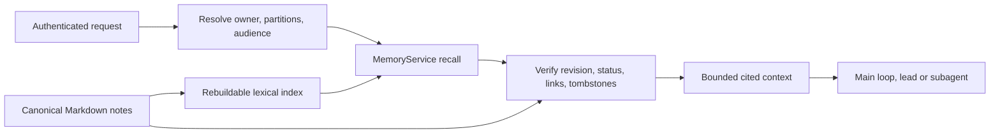

# Proposed native Markdown memory design

**Status: rev 4.8 (2026-09-24): the owner has answered MD-1…MD-9 (§0) and the three decisions the rev-3 audit raised (G2, G30, G38); slices 0–3 are implemented (see the [implementation plan](04-implementation-plan.md)'s revision log), slice 4 is not started; the slice-3 rulings are §7c's last table (R1–R9).** Rev 4 applies the [audit of rev 3](07-audit-gaps.md) — 49 verified gaps, G1–G49 — and adds **§7a, the frozen contracts** that slice 1 could not freeze from rev 3. Rev 3 applied the owner's answers and the instruction that the old engine be removed completely. Rev 2 applied the [review](05-review.md). Every change traces to evidence in [06a–06d](05-review.md#method) or to a gap in 07, and the revision log at the end lists which gaps each change closes. See also [the audit](01-code-audit.md), [framework research](02-framework-research.md), [filesystem research](02-filesystem-research.md) and the [implementation plan](04-implementation-plan.md).

## 0. Owner decisions

Rev 1 adopted these silently. They are product decisions, so they went to the owner (project rule: a default that reverses an accepted design or widens a component's job is a decision).

**Answered by the owner on 2026-09-23.** Seven followed the recommendation: MD-1, MD-2, MD-3, MD-4, MD-5, MD-7 and MD-8. Two did not, and the rows below record what was chosen:
- **MD-6: refuse and reset.** Existing data is not converted.
- **MD-9: everything at once.** The GUI ships with the cutover.

**Also decided (owner, 2026-09-23):** "the old memory system with the 768 sql design should be completely removed too, since the app is never released." Nothing of the old engine survives the cutover:
- `memory`, `memory_fts` and `memory_vec float[768]`, and their triggers
- the repositories, models, KB importer and chunker
- the embedder, the indexer and decay
- their config keys, CLI options and docs

There is **no compatibility code** for it: no conversion, no leftover-key warnings, no legacy-cache cleanup command. The factory reset that MD-6 requires already deletes `llm.toml` and restores `daemon.toml`, so no old key can survive to be warned about.

**Decided on the rev-3 audit (owner, 2026-09-23).** Three of the audit's gaps were decisions rather than document fixes. Each is written into the section it governs; this is the record:
- **G2 — a model tool call never mints origin `user`.** `MemoryAccessContext` carries `surface: UserSurface | ModelTool` (plus the internal `Extraction`, §3); only the API, the CLI and the GUI write origin `user`; a `ModelTool` `memory_store` or edit records `extracted_user`; `confirm` is refused by the tool with a message naming the app's Memory view and `openalpaca memory confirm`; a `ModelTool` supersede of a `user`-origin note is reported as a conflict, not applied. "User-directed surface" is defined once, in §4. *(Decided by the owner on 2026-09-23.)*
- **G30 — the Memory view is a fifth top-level view** in the side nav, beside Chat, Work, Library and Settings, **and a `memory_changed` `ServerEvent` ships with the routes** (3.8) — persisted nowhere, like `daemon_shutting_down` — so the view invalidates its queries on it instead of polling. *(Decided by the owner on 2026-09-23.)*
- **G38 — no `USER.md` inventory command.** The cutover does not inventory or propose moving the lines the background writer extracted into `USER.md`; the switch-over note (plan §4) tells the owner to review the file by hand. *(Decided by the owner on 2026-09-23.)*

**Ruled by the session lead (2026-09-23), recorded as a ruling, not an owner decision — G12:** baseline B is measured in slice 1 in the developer's scratch store with a one-time, explicitly authorized download of the E5 model into that scratch store's `state/cache/fastembed`; the download is part of B's recorded conditions; it is a developer benchmark, not a test, so "tests never reach `localhost:11434`" and "no network in tests" are untouched. If the download is refused, the gate is against A with a −10 pp margin and the report says so (plan §5).

| Id | Question | Recommendation (what rev 2 is written for) | Alternatives and their cost |
|---|---|---|---|
| **MD-1** | Retire embeddings and sqlite-vec with **no** optional semantic path in v1? | **Yes.** Every consumer is memory ([06b](06b-evidence-embedding-inventory.md)). The removal drops 97 of the daemon's 465 dependency packages (96 for `fastembed`, 1 for `sqlite-vec`), the ONNX Runtime library that `ort-sys` fetches at build time (about 67 MB unpacked), and the ~1 GB first-boot model download that the seeded `llm.toml` switches on for every install. | Keep an optional embedder behind a flag. That preserves paraphrase recall but keeps the whole dependency chain in the build. |
| **MD-2** | What does **automatic** learning produce? | **Decide by source role.** A preference or fact stated in the **user's own words** becomes an **active** note with origin `extracted_user`. It has lower authority than an explicit save, never overrides a user-authored note, and appears in a *recently learned* list with one-step undo. Anything inferred from assistant text or tool output stays a **candidate**, outside recall until confirmed. | Rev 1: every extraction is a hidden candidate until reviewed. That is safer, but the assistant stops learning until a review surface ships ([06c](06c-evidence-identity-scope-learning.md) A6). |
| **MD-3** | What happens to the background `USER.md` writer? | **It stops writing learned facts into `USER.md` at cutover.** Learned preferences become memory notes. In the **same** slice, an explicit `USER.md` editor ships (`openalpaca persona edit user` and Settings → Persona), and onboarding completion stops depending on the background writer. `update_persona` stays during bootstrap. | Keep the writer. Two stores then hold learned preferences, and `USER.md` keeps its system-prompt authority for inferred text. |
| **MD-4** | Group chats: rev 1 blocked recall in "group lanes". | **v1 keeps today's lane model.** No group lane exists: a connector lane mixes every DM and group on that platform, and core cannot tell them apart ([06c](06c-evidence-identity-scope-learning.md) A1–A3). Group privacy becomes its own *connector audience* design, covering `USER.md`, transcript, notices and memory together. | Block recall on every connector lane. That also switches recall off in the owner's own DMs. |
| **MD-5** | Which workspace scopes memory? | **The project root found from the request workspace**, by the marker walk memory uses today (`.openalpaca`, else `.git`; `crates/openalpaca_core/src/memory/workspace.rs`). The project store is created lazily on the first project write, as artifacts do. A directory with no marker is global. The daemon's own CWD never selects a project. The CLI sends its CWD on every turn, so rev 1's rule would scatter partitions into arbitrary directories. This **extends ADR-031**, whose CWD-derived `workspace_id` "keeps doing memory scoping". | Rev 1: any explicit request workspace, the CLI's CWD included. An earlier rev-2 draft required an *existing* store, which splits one project's facts before and after its first artifact creates the store (`artifact_write.rs:53-57`). |
| **MD-6** | What happens to existing schema-42 memories (the owner's real store has them)? | **Answer: refuse and reset.** The baseline is re-squashed to 43 without memory tables, and a schema-42 database is refused like 1–41. The owner runs `openalpaca config reset --factory`, which also removes tasks, sessions, usage and `llm.toml` with its API keys. The refusal still works without sqlite-vec ([06d](06d-evidence-vec0-spike.md) Q1). Plan §4 has the refusal text and the switch-over note. | *Recommended, not chosen:* migration 043 in the new build (backup, export to Markdown, stub-`vec0` retirement), keeping every non-memory row. |
| **MD-7** | Is project memory git-ignored? | **Yes, by a self-contained `.gitignore` (`*`) inside `<project>/.openalpaca/memory/`**, written when the partition is created and re-asserted on every open (§2). It works for existing projects and never edits the user's ignore rules. The seeded README text is refreshed. | Today's stated stance: memory is committed with the project. |
| **MD-8** | Fix the current engine's **data-loss** behaviour before the replacement lands? | **Yes, as slice 0**, when the cutover is more than about two weeks away. The fixes: <br>- stop decay pruning <br>- turn off similarity-based replacement for **every** caller, keeping exact-hash dedup only <br>- scope the lead's injection to global when there is no workspace (F1) <br>- stop `config reset` deleting the owner id (a bug) <br>- refuse a database whose schema is newer than the build knows | Wait. Memories in the owner's live store keep being pruned or replaced in the meantime ([05](05-review.md) finding 2). |
| **MD-9** | Which management surfaces ship with the cutover? | **Answer: everything at once.** The API, the CLI and the GUI Memory view (with the Settings → Persona editor) all ship in the cutover. | *Recommended, not chosen:* API and CLI with the cutover, and the GUI in the next slice. |

## 1. Decision and scope

Replace the persistent `MemoryRepository`/vector-memory subsystem with a native Rust `MemoryService`:
- **Markdown files** hold canonical knowledge.
- **One small control snapshot per partition** holds what must not live in editable prose: revisions, origin and tombstones.
- **A separate SQLite FTS5 database** holds disposable search data only.

SQLite stays for conversations, tasks, identities, usage, artifacts and other application state.

The default memory path has no embedding model, reranker, learned tokenizer assets, Python/Node sidecar, model download or network call. Unicode term splitting and substring indexing are ordinary algorithms. Optional extraction uses the existing configured conversation model and its normal cost accounting; it is never required to store, browse, search or delete a note.

This removes the memory model's startup and dependency burden (measured in [06b](06b-evidence-embedding-inventory.md)). Better answer accuracy is a hypothesis to test. That said, today's per-turn recall barely works ([05](05-review.md) finding 1), so the bar is low for the automatic path and real for the tool path. The main quality improvements sought:
- consistent scope enforcement
- explicit corrections
- reliable forgetting (no silent pruning, no similarity replacement)
- source evidence
- predictable context selection

Low-overlap paraphrase and cross-language recall remain the known weakness of lexical search.

Retain conversation compaction, summaries, session logs, task state, skills, `SOUL.md`, `IDENTITY.md` and `USER.md`; they are separate systems. Do not delete the credential `TokenManager`: it manages authentication, not text tokenization. Do not turn retrieved notes into agent instruction files. The KB importer (`memory/kb.rs`, `memory/chunker/`) has **no production caller** since `5ec1db1d` deleted the `/v1/memory*` routes ([06a](06a-evidence-audit-verification.md)), so it is deleted, not ported.

## 2. Fit the existing store

Use `store::content_dir(StoreScope, ContentKind::Memory)`. That content kind already exists, and the home/project READMEs reserve `memory/`. Add helpers to the existing store module rather than joining literal paths throughout core.

```text
<home-store>/memory/owners/<owner-key>/
  MEMORY.md                          generated navigation index; rebuildable
  notes/<uuid>--<slug>.md            canonical notes (active, archived, candidate)
  .history/<uuid>/<revision>.md      the last 5 service-written revisions, the current one included; never auto-retrieved

<project>/.openalpaca/memory/
  .gitignore                         "*", written with the first partition and re-asserted on every open (MD-7)
  owners/<owner-key>/                ...same shape as the home partition...

<home-store>/state/memory-control/<partition-key>.json
                                     one control snapshot per partition (§6, §7a)
<home-store>/state/cache/memory-index-v1.sqlite
                                     disposable catalog, chunks, FTS indexes
```

- `<home-store>` means `store::home_root()`, including `OPENALPACA_HOME_STORE`. No home path is hardcoded.
- **`<owner-key>`** is the first **32** lowercase hex characters of SHA-256 over the UTF-8 bytes of `owner_id`. Owner ids can be arbitrary strings: `link_generate` accepts any `user_id` ([06c](06c-evidence-identity-scope-learning.md) A5). The mapping back to the owner id is recorded in the control snapshot.
- **`<partition-key>`** is `home-<owner-key>` for the home partition, or `proj-<owner-key>-<dir-key>` for a project partition, where `<dir-key>` is the first **16** lowercase hex characters of SHA-256 over the UTF-8 bytes of the **canonical partition directory** string — `<project>/.openalpaca/memory/owners/<owner-key>` after `canonicalize()`, the way `store::project_root_at` addresses artifact rows by the resolved store directory rather than by the path the caller named (`crates/openalpaca_storage/src/store/mod.rs:612-624`). Two projects whose `.openalpaca` resolve to one directory therefore share one partition and one snapshot; keying on the project root would give them two snapshots over one `notes/`. On Windows the canonical string carries the `\\?\` prefix `canonicalize()` returns; it is hashed as returned, so the key is stable on that machine and not portable across machines (no key is). A workspace move renames the snapshot along with the rebinding (§3, §6).
- **The filename is `<uuid>--<slug>.md`**, where `<slug>` is `store::artifact::slugify(title, 48)` (`store/artifact.rs:144-170`: NFKD-folded to `[a-z0-9-]`, byte-bounded, Windows reserved names guarded; it returns `artifact` when nothing is left, and `memory_files` substitutes `note` for that one value). The grammar cannot produce `/`, `..`, a leading `.` or a control character, so a retitle can never be refused or escape. The slug is presentation only: **the UUID is the identity**, and a retitle renames the file in one atomic rename.
- Store helpers exclude `.history`, `.gitignore` and temporary files from note scans.
- Control snapshots sit under machine state, outside the editable content roots. The snapshot binds partition id, owner key and canonical root, and a workspace move updates that binding (§3).
- **Modes.** `memory/`, `owners/<owner-key>/`, `notes/` and `.history/` are created with `store::create_private_dir` (0700 on Unix, `store/mod.rs:736-746`) in both scopes, and every note, temp and history file is opened with mode 0600 (`OpenOptions::mode`). Today every memory row lives in `state/openalpaca.db` under a 0700 `state/`; a note must not become readable by other local accounts by moving to a content directory that `content_dir` creates with the umask default (`store/mod.rs:586-597`). A Unix test asserts the modes.
- **The project `.gitignore` is store-owned.** On every partition open, `memory_files` reads `<project>/.openalpaca/memory/.gitignore` and rewrites it atomically when its bytes are not the service's text (`*\n`). The store's other seeded files are write-when-absent (`store/mod.rs:485-511`), which would leave a cloned repository's force-added `!*` in place and let the next `git add -A` stage the owner's notes. A test replaces a pre-existing `.gitignore` with other content.

**Why a control snapshot is necessary.** Knowledge lives in Markdown, but three things must survive deletion of the search cache: a forgotten-source tombstone, the service's record of which revision it wrote, and the origin of each note. That is one small JSON file per partition (§7a has the schema), not a second knowledge database. The memory tools cannot reach it by construction, and the daemon's generic file tools **refuse** it: `file_write`, `workspace_write` and `file_read` refuse any path whose first component is `state`, and `file_write`/`workspace_write` also refuse a partition's own control files — `.history/`, `MEMORY.md` and `memory/.gitignore` (plan 3.2). The builtin registry captures the daemon's CWD as its workspace root, and both launchers start the daemon in the home store, so without that refusal `file_write("state/memory-control/…")` would reach the snapshot and `file_read` would disclose the owner-id mapping.

Path checks alone do not confine shell or MCP subprocesses running with the same OS identity. Existing unrestricted host execution is equivalent to a trusted administrator for this guarantee, and nothing here claims resistance to the machine owner. Shell and MCP subprocesses are the stated residual; the builtin file tools are not.

A complete backup or export includes notes **and** the control snapshot. If a partition's snapshot is missing or invalid:
- automatic recall, extraction and replay for that partition are quarantined until `memory doctor --repair` (§6, *Management operations*) — the only way out;
- explicit reads still work, and every note is labelled `unverified`;
- empty controls are never silently initialized over existing notes.

A fresh empty partition is initialized atomically. A copied `.md` dropped into `notes/` by hand is picked up by the next reconciliation scan as origin `external` (§4): human-readable, searchable, low authority. It never inherits identity, authority or forget history, and there is no import verb in v1 (§9).

**A factory reset does not touch memory.** `openalpaca config reset --factory` deletes the database trio and the two config files and leaves `state/memory-control/` and `state/cache/memory-index-v1.sqlite` untouched, so an orphaned partition keeps its snapshot — its tombstones and its owner-id mapping — for `adopt` (§3). The index is validated and rebuilt on the next start if it does not match the partitions. The reset preview names both entries (plan 3.7).

Do not create one enormous memory file or copy every conversation into a journal. The DB holds the conversation text, and the session log holds only previews ([06c](06c-evidence-identity-scope-learning.md) A11). Start with a shallow `notes/`, and add topic folders only when browsing tests show a need. `MEMORY.md` lists IDs, titles, descriptions and relative links; it is not another authoritative copy of facts.

## 3. Ownership and scope are enforced by the service

Every operation receives a typed `MemoryAccessContext` from the authenticated request or agent runtime. Its fields — owner, project root, surface, capabilities, attribution — and **who constructs it on each surface** are in §7a (*`MemoryAccessContext`*). None of them ever comes from LLM tool arguments or a Markdown header. Identity resolution is reused; no parallel owner system is invented. Two rules of construction:
- **The owner is a `global_user` row.** Construction accepts an id only when `SELECT 1 FROM global_user WHERE id = ?1` finds it (`001_baseline.sql:15`); anything else — the `"system"` sentinel a `/v1/command process` turn and every workflow it starts carry (`ToolContext::created_by()`, `tools/registry/mod.rs:149-158`), or a `provider:id` string of an unlinked external identity — yields **no owner**: nothing is recalled, nothing is extracted, and the tools refuse. Without this, every API-originated run would share one ownerless `home-<sha256("system")>` partition written by extraction and readable by any worker with `memory_read`.
- **The surface is set by the constructor, never by the caller of a tool.** `UserSurface` is exactly the API, the CLI and the GUI (§4); `ModelTool` is every tool call, whichever loop made it; `Extraction` is the background extractor.

Rules:

1. **The project partition is the project root found from the request workspace** by the marker walk (`.openalpaca`, else `.git`; MD-5). The store is created lazily on the first project write, as artifacts do. A request with no workspace, or a workspace with no marker above it, reads and writes only the owner's global partition. The daemon's own CWD never selects a project. The partition directory itself is resolved once per open by walking `<project>` → `.openalpaca` → `memory` → `owners/<owner-key>` → `notes` with `symlink_metadata` on every component; when any component is a symlink, a junction or not a directory, the project partition is **refused** and the operation falls back to the global partition with one WARN naming the component. The marker walk and `content_dir` both follow links (`memory/workspace.rs:64-77`, `store/mod.rs:586-597`), and `confine_to_root` canonicalizes the root first, so a git-committed symlink at any of those levels would otherwise place the owner's notes wherever it points.
2. **With a project store**, reads cover global plus that project for the same owner. Default write scope depends on kind:
   - `preference` defaults to **global**, because a preference stated in a project chat is still the user's;
   - `fact`, `decision`, `procedure`, `reference` and `episode` default to the **project**;
   - an explicit `NoteScope` (§4) overrides the default.
3. A project note outranks a global one only for the same explicit `fact_key`, and only where authority permits (§4). **Within one partition**, two active notes with the same `fact_key` and no `supersedes` link between them are resolved the same way: the highest-authority note wins; among notes of equal authority, the newest `observed_at` wins when every one of them has one; after that (or first, when any lacks one) the note first written most recently (the newest `created_at`, which no edit moves), then the newest `updated_at`, then the lowest id (§7c R9); the loser stays on disk, is excluded from automatic recall, and is reported as `conflict` by `memory_search`, by `doctor` and in the GUI. Textual similarity never hides a global note, and a lower-authority note never overrides a user-authored one.
4. **Scheduled skills** are global: none has a persisted workspace binding (`apps/openalpacad/src/scheduled_skills.rs:208` sends no workspace). **Follow-ups** replay their stored `workspace_path` through rule 1. **Subagents** inherit a narrowed context and the existing denied-section and tool rules. Fresh searches enforce the same rules as parent-context distillation.
5. **Audience:** v1 keeps today's lane model (MD-4). Memory adds no exposure that `USER.md` and the shared transcript do not already have. Connector audience (DM vs group, non-owner senders) is a separate design, and the iMessage non-owner-as-owner defect is its own task ([05](05-review.md)). Markdown can never set or widen audience.
6. **Unknown fields are rejected.** Tool input carrying `owner_id`, `workspace_id`, an absolute path or trust fields is refused. The tool registry's validator today accepts unknown keys (F2), so the memory tools validate strictly themselves (`additionalProperties: false` on every schema in §7a). Every read-by-ID and every mutation re-checks ownership and scope, even after a search.

Note IDs are UUIDs, and citations use partition-relative paths; absolute workspace paths are not baked into records.

**Workspace move.** No move lock exists today ([06c](06c-evidence-identity-scope-learning.md) A7). `PATCH /v1/workspaces` is preflight → one DB transaction → `rename(2)` (`routes/workspaces.rs:499-504`, `store/project_move.rs:77`), and the memory service is threaded through it in this order:
1. The preflight calls `MemoryService::quiesce(partition)`, which refuses the move while a memory write for that project is pending and holds new writes until step 5.
2. The service writes the snapshot under the **new** partition key — the binding is the new canonical directory, and `moved_from` names the old key — before anything is renamed.
3. The route runs its DB transaction (`rebase_project`, minus the memory SQL that goes with the table).
4. `move_project_store` renames the directory.
5. The service deletes the old-key snapshot, invalidates the project's catalog entries and releases the hold.

A crash between any two steps leaves a state `doctor` can name (§6, recovery table, row *workspace move*).

**Resets.**
- A plain `openalpaca config reset` deleting `identity.local_user_id` is a **bug**, fixed in slice 0 (plan §2): config reset must not delete `identity.*`.
- A factory reset deletes the database, so the next boot mints a new owner id with a different owner key. The old partitions survive as files **with their snapshots** (§2), and are listed by `memory doctor` as *orphaned*.
- `openalpaca memory adopt <owner-key>` re-binds an orphaned partition to the current owner (pre- and post-conditions in §6, *Management operations*). It is a local management command: no tool provides it and no route serves it. Nothing is inherited automatically.
- Update the factory-reset preview, which today says memories go with the database, and test it.

## 4. A small, versioned note format

Illustrative v1 file, in the service's canonical serialization (below); the UUIDs and ids are examples, not existing data:

```markdown
---
schema: 1
id: 55e811b6-3220-4758-a47b-034bd1023f38
title: Build and test commands for this workspace
kind: procedure
status: active
fact_key: build.validation
aliases:
  - checks
  - validation
  - 测试
  - 编译
tags:
  - development
created_at: 2026-09-23T10:00:00Z
updated_at: 2026-09-23T10:00:00Z
observed_at: 2026-09-23T09:55:00Z
valid_from: null
valid_to: null
review_after: null
pinned: false
sources:
  - type: task
    id: 7c1e0b2a-4d61-4f0e-9a3c-2b7f1d5e8c90
    observed_at: 2026-09-23T09:55:00Z
supersedes: []
---
# Build and test commands for this workspace

## Knowledge
Run the documented focused checks for the component being changed.

## Evidence and limits
The cited run checked one component. It did not certify the entire application.

## Recheck when
The build configuration or test entry points change.
```

**Fields.**
- Required: `schema`, `id` (UUID), `title`, `kind`, `status`, `created_at`, `updated_at` and a Markdown body.
- Optional: `aliases`, `fact_key`, `tags`, `observed_at`, `valid_from`, `valid_to`, `review_after`, `pinned`, `sources` and `supersedes`.
- `kind` is the enum **`NoteKind`**: `fact`, `preference`, `decision`, `procedure`, `reference`, `episode`. Scope is the enum **`NoteScope`**: `global`, `project`. (The old `MemoryKind`/`MemoryScope` die with `models/memory.rs`; the completeness search in plan §3 forbids the old names, so the new ones differ.)
- `status` is **`NoteStatus`**: `active`, `candidate`, `archived`. **Superseded is not a stored status.** It is derived from links (§6), so replacing a note never rewrites the old file.
- `fact_key` matches `[a-z0-9][a-z0-9._-]{0,63}`; anything else is rejected at write time and treated as absent when found in an external file.
- `sources` entries are `{type: message | task, id, observed_at?}` — DB ids, never session-log offsets.
- `supersedes` in the **file** is a list of note ids (a user may edit it); the tool and API inputs that create a link take one `{id, expected_revision}` (§7a).

**Canonical serialization** (the revision is a byte hash, so the bytes must be reproducible):
- Frontmatter keys are written in the order shown above; unknown keys follow them in the order they were read. Lists are block style (`- item`), one item per line; scalars are unquoted unless YAML requires quoting; timestamps are RFC 3339 UTC to the second with `Z` (never `+00:00`, never sub-seconds); an absent optional is written as `null`. YAML comments are **not** preserved — a parse-and-write of a hand-commented file loses the comment and changes the revision once, after which it is stable.
- The service parses frontmatter with `serde_yaml` (already in the workspace at `Cargo.toml:43`; the storage crate gains `serde_yaml.workspace = true`, one edge, no new crate) and writes it through its own emitter in the form above, so the canon does not depend on `serde_yaml`'s output style. The body is written byte-for-byte as read or as given.
- A parse followed by a write of an unchanged note is **byte-identical**, and a no-op patch does not change the revision. A round-trip test pins this on the example above, on a note with unknown keys, and on CJK aliases.

**Authority** is not in the frontmatter. The partition decides owner and scope. The control snapshot records, per note, the revision the service last wrote and its **origin**. **A user-directed surface is exactly the HTTP API (`/v1/memories*`, `/v1/persona/user`), the CLI verbs that call it, and the GUI** — `MemoryAccessContext.surface == UserSurface`. A tool call is never one, whichever loop made it and whatever the model was told (G2, owner decision). Origins, and who can record each:
- `user`: an explicit save, edit, confirm or supersede through a **user-directed surface** — and nothing else
- `extracted_user`: extracted from the user's own words (MD-2) by the background extractor, **or written by a model tool call** (`ModelTool` `memory_store` and `memory_update edit`): the model saying "the user told me" is the same trust level as the extractor saying it
- `extracted_other`: inferred from assistant or tool output, always a candidate
- `imported`: **reserved**, with no producer in v1 (an import verb is a separate feature, §9); it keeps its rank so the ordering does not move when one ships
- `external`: the file's bytes no longer match the recorded revision, or the service never wrote the file (dropped in by hand)

Confirming a candidate makes it `active` with origin `user`. It is a user-directed act: `POST /v1/memories/{id}` with `action: confirm`, the GUI's confirm button, `openalpaca memory confirm <id>`. **The tool refuses it** — `memory_update` with `action: confirm` from a `ModelTool` context answers *"Confirming a remembered candidate is done by you, not by me: open the Memory view in the app, or run `openalpaca memory confirm <id>`."* and writes nothing.

Authority ordering: `user` > `extracted_user` > `imported` > `external` > `extracted_other` — five ranks, strictly ordered: an external edit cannot retire an import. An external edit **downgrades** a note to `external` until a service write re-records it. Sources in the note are readable claims, not proof. An LLM-produced confidence number is not calibrated evidence and is not stored as authority.

**What a model tool call may do to a `user`-origin note.** A `ModelTool` `memory_store` whose `supersedes` names a `user` note, and a `ModelTool` `memory_update edit`/`archive` of one, are **refused** with `authority_conflict` naming the note and the two user-directed ways to do it; nothing is written. (Applying the edit would re-record the note as `extracted_user`, a silent downgrade of the user's own words.) A `ModelTool` `memory_forget` of a `user` note is allowed **under its confirmation prompt** (§7, *Capabilities*): the card is the user's own act, and a forget records no origin.

**Times.** `valid_from`/`valid_to` define a half-open effective-time interval only when evidence supports it; unknown bounds stay null. Current recall excludes notes whose interval has ended, and a historical query evaluates the requested date. `review_after` only requests a recheck; it is never an expiry or deletion.

**Revisions.** A revision is the **lowercase hex SHA-256 of the file's exact UTF-8 bytes** (64 characters), returned by the service, never embedded in the file. The snapshot records the one the service last wrote; a file whose current hash differs is `external`.
- `expected_revision` is mandatory for update, archive, confirm, supersede and forget.
- Untouched Markdown and unknown extension fields are preserved during supported patches (the canon above is what makes "untouched" mean byte-identical).
- Duplicate required keys, invalid timestamps, duplicate IDs and oversized records are rejected with a visible diagnostic. Malformed external files stay on disk, excluded from automatic context, and are never rewritten or deleted during recovery.

**Initial limits** (tune through evaluation):

| Limit | Value |
|---|---|
| Note size | 32 KiB |
| Chunk size | about 1–2 KiB, on heading/paragraph boundaries |
| Combined automatic memory context, pinned notes and wrappers included | 8 KiB |
| Retrieved chunks | at most 8 |
| Explicit tool read response | 32 KiB |
| Extracted notes per chat turn / per task run | 5 / 10 (`[orchestrator.costs] extract_max_items_per_turn`, `task_extract_max_items_per_run`; plan 3.4) |

These are byte limits, and the existing budgeting system reserves the headroom. Replace the language-insensitive estimate for this section with a conservative one, and test it on Chinese, emoji and long identifiers.

## 5. Read path: one implementation for every agent



The same `MemoryService::recall` serves `prompt_ctx::MemorySource`, the lead-agent bootstrap and `memory_search`. The lead agent's direct repository query is removed.

**The profile is injected once per turn**, and the survivor is the persona layer's static system-prompt block: `compose/persona.rs` `user_document_block` (priority `High`, budgeted by `[orchestrator.prompt_budgets] user_profile_budget`, cached with the rest of the static layer). `prompt_ctx::sources::UserProfileSource` — the second, `Normal`-priority `SystemMessage` section — is **deleted**, and the lead, which passes `user_document: Arc::new(None)` to the persona layer today (`runner/lead_agent/prompt.rs:213`) and received the profile only through the deleted source, passes its user document to the persona layer instead. **The memory section leaves the cached dynamic-context layer.** Today it is cached by query text with `memory_retrieval_hash` zeroed ([05](05-review.md) finding 3; `simple_query_handler.rs:550,1050`, `lead_agent/prompt.rs:244`, `lead_agent/tools.rs:506`); after the cutover the service builds it per turn — it is cheap (§5's 50 ms bound) — and appends it outside the fingerprinted layer, so `DynamicContextInput.memory_retrieval_hash` and its four zeroing sites go. Retrieved-data trust labels are preserved in all prompts and handoff packages.

Deterministic retrieval steps:

1. **Resolve allowed partitions** before searching (§3). An unknown or unauthorized root fails closed.
2. **Select a few active pinned notes** within a separate sub-budget (initially 2 KiB of the 8 KiB). `MEMORY.md` is optional navigation, not unbounded startup content. Pinned notes are still untrusted reference data.
3. **Search.** Normalize the query and keep exact identifiers and paths alongside Unicode-normalized terms. Search titles, aliases, tags and body with FTS5/BM25 over a **union of terms**. Today's per-turn path requires every word of the whole message and matches almost nothing ([06c](06c-evidence-identity-scope-learning.md) A6). Build query syntax from escaped literal terms (an AST), never from caller-supplied `MATCH` expressions. This removes the F4 class of defect.
4. **Term routing.** Every normalized term of **three or more characters is ORed against both tables** — the `unicode61` table and the FTS5 trigram companion — with a trigram-only hit weighted below a whole-token hit. The trigram companion is not CJK-only: it is what finds `prefer` inside `prefers`, and without it "what editor do I prefer?" matches nothing under plain `unicode61` (07 G23, reproduced on SQLite 3.51: 0 rows `unicode61`, 1 row trigram). No stemmer is added: `porter` would also pass that fixture, but it is English-only and changes what "exact" means for identifiers and CJK. Phrases and exact identifiers are matched as literals on the trigram table. One- and two-character queries use a bounded scoped substring pass. Return `partial: true` when a scan cap is hit, and do not claim complete Chinese retrieval from `unicode61`.
5. **Filter, then limit.** Union and deduplicate the candidates. Filter owner, scope, kind, status, **derived supersession**, tombstones, same-`fact_key` losers (§3 rule 3), audience and effective validity **before** the result limit. Preserve ranking evidence through context assembly, never replacing it with generic importance.
6. **Rank** by exact title/alias hits, lexical relevance, authority (§4), explicit validity and a modest recency tie-break. Pin and test the weights, and do not claim they are optimal. Superseded and archived notes are excluded unless the user explicitly asks for history. Same-key overrides are resolved before budgeting.
7. **Verify.** Reopen the selected files with confined handles, re-hash them, and check status, links and tombstones. Return current excerpts with note ID, relative path, heading, line range, revision, sources, match reason and freshness. A dirty or deleted note is never served from cached text.
8. **Budget and deliver.** Budget whole chunks when possible and mark truncation. Deliver as quoted data in user or tool context, never as a system instruction. A citation resolves to the revision actually read. After eviction or forgetting it reports `revision_unavailable` or `deleted`, and a source whose DB evidence is gone reports `evidence_unavailable`. **What was delivered is reported**: the turn's `HandleResult`/`GatewayResponse`/SSE `done` carry `memory_used: [{id, revision, reason}]` (§7a), omitted when empty and persisted nowhere, and the service keeps an in-memory ring of recent deliveries that `GET /v1/memories/recently-used` reads.

The default recall/search path invokes no model. When lexical evidence is weak, the running agent may issue up to two revised searches within its existing loop and cost budget, then abstain or explain the gap. There is no hidden query-expansion agent or neural reranker. Cross-language aliases come from the user or from an already-budgeted write.

**Freshness without a watcher.** Correctness does not depend on filesystem events. The wake watcher cannot add paths after start, and core may not depend on it ([06c](06c-evidence-identity-scope-learning.md) A13). Freshness comes from four sources:
- **Service writes** update the index synchronously, giving read-after-write consistency.
- **Reconciliation** is a bounded stat scan (mtime + size + inode) of the partition's `notes/`. It runs at service start, every 30 s, before management reads, and on `sync`. Changed files are re-hashed and re-indexed, and a detected external change publishes `memory_changed` with `change: external` (§7a).
- **Verification** of every selected file (step 7) stops a stale deletion or edit from being served before reconciliation sees it.
- A missed **new** external file may be absent until the next scan, and freshness is reported.

A `notify` watcher in the daemon is an optional latency improvement, measured before it is added. Cold start opens the index if it is valid and schedules reconciliation on a blocking worker. A missing or corrupt index triggers a rebuild, and search meanwhile serves a bounded scoped file scan with `index_state: rebuilding`.

## 6. Writes, corrections, deletion and recovery

### Write protocol

There is one daemon-owned writer queue per partition. CLI and GUI mutations go through the service. Offline management (`doctor --repair`, `adopt`) takes the store lock and refuses while the daemon runs. File access uses confined no-follow handles and rejects escaping paths, symlinks and junctions, hardlink aliases where enforceable, and hidden or control-file targets; the path *to* the partition is checked component by component (§3 rule 1). The atomic write builds on `store::write_atomic` (`crates/openalpaca_storage/src/store/mod.rs:754`), hardened with a no-follow open, mode 0600, a file `fsync` and a directory `fsync` where the platform supports it. The artifact store's crash-tested put path (`crates/openalpaca_storage/src/artifacts/`) is the reference.

**Every mutation touches at most one note file.** That keeps recovery to a single pending field instead of an operation log:

| Mutation | Steps (each step atomic) | Recovery at service start |
|---|---|---|
| **create / update / archive / confirm** | 1. Snapshot: set `pending = {id, from_rev, to_rev}` (`from_rev` null on create) <br>2. Copy the **new** bytes to `.history/<id>/<to_rev>.md` (`fsync`), then write the note (temp, `fsync`, rename), then prune `.history/<id>/` to the newest 5 <br>3. Snapshot: record `to_rev` and origin, clear `pending` <br>4. Update index and `MEMORY.md`; publish `memory_changed` | File equals `to_rev`: finish step 3. <br>File equals `from_rev` or is absent: clear `pending`; the `.history` copy of `to_rev` is left (it is bounded and harmless). <br>Anything else: an external edit raced us. The note becomes `external`, and the service's own `to_rev` is in `.history`, which is why step 2 copies it **before** the rename. |
| **supersede** (replace note A with B) | A `memory_store` (or `POST /v1/memories`) carrying `supersedes: {id: A, expected_revision}`. **Create B** with `supersedes: [A]` in its frontmatter, as the create row above. A's revision is checked, not written; a changed A is a conflict and nothing is created. A's file is **not touched**: A is superseded because a qualifying note names it (below). The result is B's new UUID and revision. | As for create. |
| **forget** (ids with expected revisions) | 1. Snapshot: append tombstones (id, `supersedes` list, origin, suppressed source ids) <br>2. Delete the note files and their `.history` <br>3. Purge index and navigation; publish `memory_changed` | A tombstoned id whose file still exists: delete it. Idempotent. |
| **workspace move** (§3, five steps) | 1. quiesce <br>2. write the new-key snapshot (`moved_from` = old key) <br>3. DB transaction <br>4. `rename` <br>5. delete the old-key snapshot | Handled by `doctor`, not at service start, because the service cannot tell a move from a lost directory: a snapshot whose bound directory does not exist is **stale** when another snapshot names it in `moved_from` and that one's directory exists (`--repair` deletes the stale one — the move completed), **abandoned** when its own `moved_from` names a snapshot whose directory exists (`--repair` deletes it — the move never happened), and **orphaned** otherwise (listed, never deleted). |

**`.history` holds the last 5 service-written revisions of a note, the current one included**, in both scopes, and nothing else — not every revision. Forget deletes the note's `.history` with it.

**Derived supersession.** A note is superseded when an **active or archived note, or a tombstone**, lists it in `supersedes` and three conditions hold:
- **Same partition.** A link across partitions is ignored.
- **Enough authority.** The superseder's origin must rank **at or above** the target's (§4; `imported > external`, so a hand-dropped file cannot retire an import). A lower-authority link never hides a higher-authority note, so hand-edited frontmatter cannot retire a user's note. Such a link is reported by `doctor` and the GUI as a conflict, and both notes stay active.
- **Not a candidate.** A candidate supersedes nothing until it is confirmed.

Archiving or forgetting a replacement therefore does **not** revive what it replaced, because tombstones keep their `supersedes` lists and their origin for exactly this. Restoring an old note is an explicit update that removes the link. Only the single `pending` field needs crash recovery. A multi-note change is expressed as independent single-note mutations whose intermediate states are all valid, never advertised as atomic.

External editors do not honor app locks. The revision check prevents stale overwrites between **service** writers, and an external edit is detected and downgraded (§4). The final race with an arbitrary in-place editor is surfaced as a conflict. It is not claimed to be impossible.

Snapshots are replaced atomically and stay bounded: completed pending fields are cleared, duplicate source-suppression entries are compacted, and a live tombstone is never discarded to meet a size cap. Tests cover a corrupt or truncated snapshot, a missing file, and a crash at each step in the table.

### Management operations

- **`memory doctor`** (read-only, local or through `GET /v1/memories/doctor`) lists, per partition: quarantine (snapshot missing or invalid), orphans (a partition whose owner key is not the current owner's), conflicts (a lower-authority `supersedes` link; two active same-`fact_key` notes), unverified and malformed files, and stale/abandoned move snapshots (table above). It changes nothing.
- **`memory doctor --repair`** (local, singleton lock, refuses while the daemon runs) rebuilds a **missing or invalid snapshot** from the directory and lifts the quarantine. Preconditions: the directory's `<owner-key>` is the current owner's (otherwise it is an orphan, and `adopt` is the verb); every `.md` under `notes/` either parses or is listed as malformed and skipped; **no two parsed notes share an id** — a duplicate refuses the repair and names both files, because the service cannot choose. Postconditions: the binding is taken from the path; every parsed note is recorded at its current hash with origin `external`; `tombstones` is empty, `pending` absent, `repaired_at` stamped; the index entries for the partition are rebuilt. It also deletes stale and abandoned move snapshots. It never rewrites, moves or deletes a note file.
- **`memory adopt <owner-key>`** (local, singleton lock) re-binds every partition of an orphaned owner key to the current owner in one command: the home partition and every `proj-<old>-*` snapshot. Precondition: for every partition it would touch, neither `owners/<current-key>` nor the current-key snapshot exists in that scope — one collision refuses the whole command, naming it, and nothing is partially adopted (merging two owners' notes is not a v1 operation). Postconditions: each `owners/<old-key>` directory is renamed to `owners/<current-key>`, each snapshot file is renamed to its new key with `owner_key` and `owner_id` rewritten, and the printed list names every partition adopted. The current owner id is read from the database's `identity.local_user_id` under the lock.
- **`memory sync`** (`POST /v1/memories/sync`) runs one reconciliation scan now and reports what changed. "Management-only" means it is on no model surface; it is under the same bearer token as every other route, because the daemon has one auth level.

### Promotion and correction

- **Explicit "remember"** writes are synchronous, acknowledged only after durable success. Through a user-directed surface they record origin `user`; through the model's `memory_store` they record `extracted_user` (§4).
- **Automatic extraction** follows MD-2. User-stated preferences and facts become active notes with origin `extracted_user`, listed as *recently learned* with undo. Inferences from assistant text or tool output become `candidate`s. Failed or cancelled tasks and assistant-only completion claims never become facts. **The extractor's input is the message as typed** — `HandleRequest.content`, the `intent_source_content` the handler already keeps apart from `model_input_content` (`orchestrator/handlers.rs:28-31,49`) — never the model input, which on an attachment turn carries the files' extracted text (U2); an uploaded document therefore cannot mint an `extracted_user` note. Extraction is bounded per turn and per run by count — `extract_max_items_per_turn` (5) and `task_extract_max_items_per_run` (10) — as well as cost; an item under `memory_confidence_threshold` is dropped, and the number itself is never stored. The existing "daily" caps are counters since daemon start that never reset and never bind on a $0 model ([06c](06c-evidence-identity-scope-learning.md) A12). It runs cancellably with task attribution, with no fire-and-forget jobs.
- **Recently learned** = active notes with origin `extracted_user`, newest `created_at` first, over a window (`?since=`, default 7 days) or a count (`?limit=`, default 50). An edit or confirm through a user-directed surface re-records the note as `user` and removes it from the list. **`undo`** is a forget by id and expected revision that is refused with `409 MEMORY_NOT_UNDOABLE` once the origin is no longer `extracted_user` — the user has since made it theirs, and a plain forget is the verb for that.
- **Deduplication** is exact, within one owner and partition. Similarity can suggest a relation, never prove equivalence or contradiction, and **nothing is replaced by similarity**. A replacement is an explicit supersede with the same `fact_key`, or a user correction.
- **Updating a note** uses its ID and expected revision. Observation time is kept separate from effective time.
- **`USER.md`** (MD-3): it is reserved for deliberately configured identity and interaction instructions. The background profile writer stops writing learned facts into it; they go to memory notes instead.
  - An explicit editor ships in the same slice: `openalpaca persona edit user` and Settings → Persona (MD-9), both through **`GET /v1/persona/user`** and **`PUT /v1/persona/user`** (§7a): raw Markdown, `If-Match` on the file's SHA-256, 409 on conflict, the same backup-and-atomic-write path `update_persona` uses (`tools/builtins/update_persona/mod.rs:121-134`). A concurrent bootstrap `update_persona` changes the hash, so a stale editor gets a 409 rather than overwriting it.
  - Onboarding completion stops depending on the background writer.
  - The lines the old writer already extracted into `USER.md` are the owner's to keep or remove by hand (G38, owner decision); the switch-over note says so.
  - A persona instruction that conflicts with a memory note is surfaced for an explicit persona edit, not silently overridden.
  - A forget result names retained persona or transcript copies when known.
- **Decay and automatic pruning of durable knowledge are removed.** `review_after` marks staleness, not permission to delete, and archiving is explicit.

### Forget contract

`memory_forget` takes explicit IDs and expected revisions, never "delete the best lexical match". A natural-language request first searches and selects, and ambiguous matches are resolved before deletion. On an attended turn the tool's `destructive_hint` raises the ordinary confirmation card (§7, *Capabilities*), which is the user's say-so; on an `unattended` turn it is refused before it runs. Nothing beyond that is asked.

Forget removes the canonical notes, their `.history` copies, navigation entries, index rows and any live memory-context cache. It records durable tombstones and suppresses extraction replay for the affected source ids. A note whose `sources` cite a forgotten note is **derived** `source_forgotten` at read time and kept out of automatic recall until it is edited. No other file is rewritten, so the one-file rule holds. **The hard guarantee:** no retrieval or replay resurrects the known records or source ids, including after an index rebuild or a restart that recovers a `pending` write.

**Limit:** tombstones live in the partition's snapshot.
- A **lost or corrupt** snapshot quarantines the partition (§2), so nothing is recalled rather than something resurrected.
- An **older snapshot restored from a backup** lacks tombstones written after that backup, so a restore is an explicit management action whose preview lists the notes it would bring back.

Transcript messages, session logs and external backups are separate data. The forget result states whether they remain and points at their existing deletion controls; it does not claim the memory action erases every copy. Raw source text still visible in the active conversation can still influence an answer, so memory sections are refreshed and the boundary is stated. Semantic re-expression from new evidence cannot be blocked by hashes, and a new explicit user instruction may intentionally reintroduce a fact. Historic sessions are not re-extracted by default. Tombstones store ids and source suppression, never the forgotten plaintext. There is no automatic Git history or cloud sync.

## 7. Tools, API and app surfaces

These are provider-neutral contracts; §7a is the frozen wire form. Familiar names are kept where useful, and old argument formats break cleanly (the app is unreleased).

| Operation | Model/tool input (full schema in §7a) | Result and enforced behavior |
|---|---|---|
| `memory_search` | `query`; optional `kind`, `scope`, `limit` (≤ 20), `historical`, `as_of` | Cited snippets, revision, match reasons, freshness and completeness; active-only by default; same-key losers reported as `conflict` |
| `memory_read` | `id`; optional `expected_revision`, `section` | Bounded current Markdown and provenance; the service re-checks access |
| `memory_store` | `title`, `body`, `kind`; optional `scope`, `aliases`, `tags`, `fact_key`, `sources` (verified DB handles), `valid_from`/`valid_to`, **`supersedes: {id, expected_revision}`** | New UUID and revision; origin `extracted_user` from a tool call. No raw path, ownership or trust accepted from the client. A `supersedes` whose target is a `user` note, or whose revision has moved, is a refusal and nothing is created. |
| `memory_update` | `id`, `expected_revision`, `action` ∈ `edit | archive | confirm`, `patch`, `reason` | Conflict or a new revision. `confirm` is refused from a tool call (§4). `edit`/`archive` of a `user` note is refused from a tool call. **Supersede is not an update action**: it is `memory_store` with `supersedes`. |
| `memory_forget` | `targets: [{id, expected_revision}]`, `reason` | Per-ID status plus the stated evidence and history scope; prompted on attended turns, refused unattended |
| `memory_list` | `kind`, `status`, `scope`, `cursor`, `limit`, `include_history`, `include_candidates` | Metadata; superseded history and candidates only on explicit request |

**Capabilities.**
- `memory_read` covers `memory_search`, `memory_read` and `memory_list`. It keeps its name and meaning, so **no agent template changes**: the six shipped templates that grant it today (`config/agents/{lead_agent,general_agent,code_agent,planning_agent,review_agent,explore_agent}.md`) keep working, and the owner's post-reset install — whose `config/agents/` the seeder skips whole and the factory reset never touches — needs no re-seed.
- `memory_write` covers `memory_store` and `memory_update`. No shipped template grants it, and the lead does not either: workers and the lead read; only the main conversation writes (below).
- `memory_forget` is destructive.
- `memory_manage` names the CLI-local verbs (`doctor --repair`, `adopt`) and nothing else. **No tool provides it**, so listing it in a template's `capabilities` grants nothing; it is not "never granted by default", it is not grantable.

**Tool annotations decide the confirmation prompt** (`annotations_for_builtin`, `tools/builtins/mod.rs:578-590`; the sandbox derives its confirmation set from `destructive_hint` when a policy lists nothing explicit, `security/sandbox/mod.rs:626-643`, and the main loop lists nothing). They are static per tool name, so a prompt cannot depend on an argument:
- `memory_forget` and `memory_update` carry `destructive_local_annotations()`: a confirmation card on an attended turn, and an immediate refusal on an `unattended` one (`sandbox/mod.rs:307`, M6) — a scheduled skill or a piped `openalpaca chat` cannot forget or archive.
- `memory_store`, `memory_search`, `memory_read` and `memory_list` carry `read_only_annotations()` or none. **A `memory_store` with `supersedes` does not prompt**: the annotation is per tool, and prompting every plain save is not acceptable; what bounds a tool-issued supersede is authority instead — it can never retire a `user` note (§4), so the notes it *can* retire are the model's or the extractor's own (`extracted_user` and below).

Map them through tool annotations, platform classification, the sandbox policy, the default agent allowlists in `config/agents/*.md` and deny settings. Workers get no write access through a globally available tool. The main conversation keeps `memory_store`, `memory_update` and `memory_forget` on its per-request surface (`tools/builtins/main_loop.rs`), as `ModelTool` calls.

**Surfaces, all shipping with the cutover (MD-9):**
- **API, with the cutover.** Typed `/v1/memories*` routes — list, search, read, create, update (edit/archive/confirm), forget, undo, history, `recently-learned`, `recently-used`, `sync` and the read-only `doctor` — and `GET|PUT /v1/persona/user`, under the existing bearer auth, in the shared `api_error` envelope (§7a has the table, the cursor rule and the error codes). Mutations take **`If-Match: "<revision>"`** — the header only, never a body field — and answer 409 on conflict. Cursor pagination, capped payloads and escaped Markdown rendering. Regenerate `docs/api/`.
- **CLI, with the cutover.** `openalpaca memory list|search|show|add|edit|confirm|undo|forget|sync|doctor|adopt` and `openalpaca persona show|edit user`, sharing the daemon's semantics (syntax in §7a). Every daemon-backed verb takes the CLI's CWD as the project (the `x-workspace-path` header `chat` already sends) unless `--global` or `--project <path>` says otherwise. `doctor --repair` and `adopt` are local-only.
- **GUI, with the cutover.** A **Memory view** — the fifth top-level view in the side nav, after Library and before Settings (G30, owner decision) — and a Settings → Persona `USER.md` editor (the ninth settings section). The Memory view has a scope selector (global / this project), search, source evidence, raw Markdown and diff against `.history`, candidates with confirm, *recently learned* with undo, revision-conflict handling and forget. Empty copy: *"Nothing remembered yet. Ask Alpaca to remember something, or add a note."* Conflict copy: *"This note changed since you opened it. Reload to see the current version — your text is kept."* A recently-learned row reads *"Learned from what you said · Undo"*. It shows which notes a response used, from the `done` frame's `memory_used` (live only; a reload reads `recently-used`). It invalidates its queries on `memory_changed` (§7a) and never polls. No model settings or cache internals appear in the editing flow.

## 7a. Contracts (frozen in slice 1)

Slice 1 freezes these as written; a change after that is a design revision, not an implementation detail. JSON property names are exact. Every object is closed (`additionalProperties: false`) unless a row says otherwise.

### The control snapshot

`<home-store>/state/memory-control/<partition-key>.json`, replaced atomically, one per partition:

| Field | Type | Meaning |
|---|---|---|
| `schema` | integer | `1` |
| `partition_key` | string | `home-<owner-key>` or `proj-<owner-key>-<dir-key>` (§2) |
| `scope` | `"home"` \| `"project"` | |
| `owner_key` | string (32 hex) | |
| `owner_id` | string | the `global_user.id` the key was derived from |
| `root` | string | the canonical partition directory (`…/memory/owners/<owner-key>`) |
| `created_at`, `updated_at` | RFC 3339 `Z` | |
| `moved_from` | string \| null | the previous `partition_key` while a workspace move is in flight; null once step 5 (§3) has run |
| `repaired_at` | RFC 3339 \| null | stamped by `doctor --repair` |
| `pending` | object \| null | `{id, from_rev, to_rev}` — `from_rev` null on create; the one field crash recovery reads (§6) |
| `notes` | object | `<uuid>` → `{revision (64 hex), origin, written_at}`; `origin` ∈ `user | extracted_user | extracted_other | imported | external` |
| `tombstones` | array | `{id, origin, supersedes: [uuid], suppressed_sources: [string], forgotten_at}`; a suppressed source is `message:<rowid>` or `task:<id>` |

```json
{
  "schema": 1,
  "partition_key": "proj-3f9a1c2d4e5b6a7f8091a2b3c4d5e6f7-0a1b2c3d4e5f6071",
  "scope": "project",
  "owner_key": "3f9a1c2d4e5b6a7f8091a2b3c4d5e6f7",
  "owner_id": "u_01J8Z3Q9K7X2M4N6P8R0S2T4V6",
  "root": "/Users/x/dev/app/.openalpaca/memory/owners/3f9a1c2d4e5b6a7f8091a2b3c4d5e6f7",
  "created_at": "2026-09-23T10:00:00Z",
  "updated_at": "2026-09-23T10:05:00Z",
  "moved_from": null,
  "repaired_at": null,
  "pending": null,
  "notes": {
    "55e811b6-3220-4758-a47b-034bd1023f38": {
      "revision": "9f86d081884c7d659a2feaa0c55ad015a3bf4f1b2b0b822cd15d6c15b0f00a08",
      "origin": "extracted_user",
      "written_at": "2026-09-23T10:05:00Z"
    }
  },
  "tombstones": [
    {
      "id": "0c7b2e4a-9d13-4c8e-b1f5-6a2d3e4f5a6b",
      "origin": "user",
      "supersedes": ["d4e5f6a7-b8c9-4d0e-9f1a-2b3c4d5e6f70"],
      "suppressed_sources": ["message:4812", "task:7c1e0b2a-4d61-4f0e-9a3c-2b7f1d5e8c90"],
      "forgotten_at": "2026-09-23T10:02:00Z"
    }
  ]
}
```

A snapshot that fails to parse, whose `schema` is unknown, or whose `root` is not the directory it was read for, is *invalid* and quarantines the partition (§2).

### `MemoryAccessContext`

```rust
pub struct MemoryAccessContext {
    /// A `global_user.id` row (§3); never from a tool argument.
    pub owner_id: String,
    /// Derived: first 32 hex of sha256(owner_id).
    pub owner_key: String,
    /// The MD-5 marker root of the request workspace; `None` = global partition only.
    pub project_root: Option<PathBuf>,
    /// Who is asking. Set by the constructor, never by a caller.
    pub surface: Surface,             // UserSurface | ModelTool | Extraction
    /// What this call may do; the service refuses anything else even if a tool was routed to it.
    pub capabilities: Capabilities,   // { read: bool, write: bool, forget: bool }
    /// For events, `memory_used` and the recently-used ring.
    pub attribution: Attribution,     // { lane_key: Option<String>, task_id: Option<String>, request_id: Option<Uuid>, source: Option<String> }
}
```

`surface` decides the origin a write records (§4): `UserSurface` → `user`; `ModelTool` → `extracted_user`; `Extraction` → `extracted_user` for the user's own words, `extracted_other` (candidate) for assistant or tool output. `capabilities` replaces rev 3's "allowed operations": for `UserSurface` all three are true; for `ModelTool` it is the sandbox-resolved capability set of the calling agent (`memory_read`/`memory_write`/`memory_forget`), so the service is a second check behind the gate; for `Extraction` only `write` is true. Who constructs it:

| Surface | Owner from | Project root from | `surface` | Writes |
|---|---|---|---|---|
| GUI/CLI chat turn — main loop and skill tier, tool calls | `ToolContext.principal` = `Principal::User { global_id }` (else no owner) | `ToolContext.request_workspace_root` (R22: the `x-workspace-path` header, never CWD-derived) | `ModelTool` | store → `extracted_user`; update `edit`/`archive`; forget (prompted); `confirm` refused |
| The same turn's automatic recall | `ContextRequest.owner_id` | `ContextRequest.scope.request_workspace_root` | `ModelTool` (read only) | none |
| Background extraction after a chat turn | the turn's owner | the turn's `request_workspace_root` | `Extraction` | `extracted_user` active, `extracted_other` candidate |
| Task-output extraction (`dispatcher/memory.rs`) | the task's `created_by`, if a `global_user` row | the task's workspace | `Extraction` | `extracted_other` candidates only (tool output) |
| Connector lanes (Telegram, Discord, iMessage) | the linked owner's `Principal::User`; `Principal::External` → no owner | none → global | `ModelTool` | as a chat turn |
| Scheduled skills | `Principal::User { local_user_id }` (`scheduled_skills.rs:203-205`) | `workspace_path: None` → global | `ModelTool`, `unattended` | forget/archive refused |
| Follow-ups | the claimed item's owner | the item's stored `workspace_path` (`followup.rs:44,152,227`) through rule 1 | `ModelTool`, `unattended` per the row | as declared |
| Lead agent | `created_by` — no partition for `system` | `workspace.request_workspace_root` (`lead_agent/mod.rs:257-263`) | `ModelTool` (read only) | none |
| Subagents | inherited from the lead, narrowed | inherited | `ModelTool` (read only) | none |
| `/v1/memories*`, `/v1/persona/user` | `state.local_user_id` | the `x-workspace-path` header (percent-encoded UTF-8, R81, `routes/mod.rs:327`), resolved by the same marker walk; absent → global | `UserSurface` | everything, origin `user` |
| CLI management verbs | through the API | the CLI's canonical CWD as that header (`chat_stream/mod.rs:116,187`); `--global` sends none; `--project <path>` sends that path | `UserSurface` | everything |
| `doctor --repair`, `adopt` | `identity.local_user_id` read under the store lock | the directory being repaired | none — offline, no service | see §6 |

### Tool contracts

Shared enums: `NoteKind` = `fact | preference | decision | procedure | reference | episode`; `NoteScope` = `global | project`; `NoteStatus` = `active | candidate | archived`; `Origin` as above; `Freshness` = `verified | stale | unverified`; `MatchReason` = `title | alias | fact_key | term | trigram | phrase`. `uuid` is the canonical hyphenated lowercase form; `revision` is 64 lowercase hex.

**`memory_search`**

| Property | Type | Required | Notes |
|---|---|---|---|
| `query` | string, 1–512 chars | yes | |
| `kind` | `NoteKind` | no | |
| `scope` | `NoteScope` | no | default: every partition the context allows |
| `limit` | integer 1–20 | no | default 8 |
| `historical` | boolean | no | default false; true includes superseded and archived notes and, without `as_of`, notes whose validity window has ended |
| `as_of` | RFC 3339 | no | evaluate effective validity at this instant |

Result: `{ "results": [{ "id", "revision", "title", "kind", "scope", "status", "origin", "excerpt", "heading", "line_range": [from, to], "match": [MatchReason], "freshness", "conflict": boolean, "sources": [...] }], "count", "partial": boolean, "index_state": "ready" | "rebuilding" }`.

**`memory_read`**

| Property | Type | Required | Notes |
|---|---|---|---|
| `id` | uuid | yes | |
| `expected_revision` | revision | no | a mismatch is `revision_conflict` with the current revision |
| `section` | string | no | a heading; returns that section only |

Result: `{ "id", "revision", "title", "kind", "scope", "status", "origin", "frontmatter": {...}, "body", "truncated": boolean, "path", "sources", "supersedes": [uuid], "superseded_by": [uuid], "freshness" }`, body ≤ 32 KiB.

**`memory_store`**

| Property | Type | Required | Notes |
|---|---|---|---|
| `title` | string, 1–200 chars | yes | |
| `body` | string, ≤ 32 KiB | yes | |
| `kind` | `NoteKind` | yes | |
| `scope` | `NoteScope` | no | default by kind (§3 rule 2) |
| `aliases` | [string], ≤ 16 | no | |
| `tags` | [string], ≤ 16 | no | |
| `fact_key` | string, `[a-z0-9][a-z0-9._-]{0,63}` | no | |
| `sources` | [{ `type`: `message` \| `task`, `id` }], ≤ 8 | no | verified against the DB; an unknown id is refused |
| `valid_from`, `valid_to` | RFC 3339 | no | |
| `supersedes` | { `id`: uuid, `expected_revision`: revision } | no | creates the successor (§6) |

Result: `{ "id", "revision", "scope", "origin", "superseded": [uuid] }`. Refusals: `revision_conflict` (the target moved), `authority_conflict` (a `ModelTool` supersede of a `user` note), `not_found`, `invalid_input`. `pinned` is not a tool input.

**`memory_update`**

| Property | Type | Required | Notes |
|---|---|---|---|
| `id` | uuid | yes | |
| `expected_revision` | revision | yes | |
| `action` | `edit` \| `archive` \| `confirm` | yes | |
| `patch` | { `title?`, `body?`, `aliases?`, `tags?`, `fact_key?`, `valid_from?`, `valid_to?`, `review_after?` } | with `edit` | untouched fields are preserved byte-for-byte |
| `reason` | string, ≤ 500 chars | no | |

Result: `{ "id", "revision", "status" }`. Refusals: `revision_conflict` (with `current_revision`), `confirm_refused` (`ModelTool`), `authority_conflict` (`ModelTool` `edit`/`archive` of a `user` note), `not_found`.

**`memory_forget`**

| Property | Type | Required | Notes |
|---|---|---|---|
| `targets` | [{ `id`: uuid, `expected_revision`: revision }], 1–20 | yes | |
| `reason` | string, ≤ 500 chars | no | |

Result: `{ "results": [{ "id", "status": "forgotten" | "revision_conflict" | "not_found", "current_revision"? }], "retained": { "transcript": boolean, "session_logs": boolean, "note": string } }`.

**`memory_list`**

| Property | Type | Required | Notes |
|---|---|---|---|
| `kind` | `NoteKind` | no | |
| `status` | `NoteStatus` | no | default `active` |
| `scope` | `NoteScope` | no | |
| `cursor` | string | no | opaque, from a previous page |
| `limit` | integer 1–100 | no | default 50 |
| `include_history` | boolean | no | superseded notes; default false |
| `include_candidates` | boolean | no | default false |

Result: `{ "items": [{ "id", "revision", "title", "kind", "scope", "status", "origin", "updated_at", "pinned" }], "next_cursor": string | null }`.

### `/v1/memories` and `/v1/persona/user`

All under the bearer middleware, all in the shared `api_error` envelope `{"error":{"code","message"}}` (`routes/mod.rs:131`) — the extension routes' flat envelope stays the one exception. A mutation's **`If-Match: "<revision>"`** header is the only place a revision is sent; a body `expected_revision` is refused as `MEMORY_INVALID_INPUT`. A successful read or write answers with `ETag: "<revision>"`. `x-workspace-path` selects the project partition as on `/v1/chat`.

| Method | Path | Body / query | Response | Errors |
|---|---|---|---|---|
| GET | `/v1/memories` | `?kind&status&scope&cursor&limit&include_history&include_candidates` | `memory_list` result | |
| GET | `/v1/memories/search` | `?q&kind&scope&limit&historical&as_of` | `memory_search` result | |
| GET | `/v1/memories/recently-learned` | `?since` (RFC 3339 or `7d`, default 7 days) `&limit` (default 50) | `{ "items": [list item…] }` | |
| GET | `/v1/memories/recently-used` | `?limit` (default 50, max 200) | `{ "items": [{ "id", "revision", "reason", "delivered_at", "lane_key", "task_id" }] }` | in-memory ring, cleared at restart |
| GET | `/v1/memories/doctor` | | the read-only report (§6) | |
| POST | `/v1/memories` | `memory_store` body | `201` + `memory_store` result, origin `user` | `409 MEMORY_REVISION_CONFLICT` |
| POST | `/v1/memories/forget` | `{ "targets": [...] , "reason"? }` | `memory_forget` result | |
| POST | `/v1/memories/sync` | | `{ "scanned", "changed", "index_state" }` | |
| GET | `/v1/memories/{id}` | `?section` `?revision` (a `.history` revision) | `memory_read` result + `ETag` | `404` |
| GET | `/v1/memories/{id}/history` | | `{ "revisions": [{ "revision", "written_at" }] }` | `404` |
| POST | `/v1/memories/{id}` | `If-Match`; `{ "action": "edit" \| "archive" \| "confirm", "patch"?, "reason"? }` | `memory_update` result + `ETag` | `409`, `428` |
| POST | `/v1/memories/{id}/undo` | `If-Match` | `{ "id", "status": "forgotten" }` | `409 MEMORY_NOT_UNDOABLE` |
| DELETE | `/v1/memories/{id}` | `If-Match` | `{ "id", "status": "forgotten", "retained" }` | `409`, `428` |
| GET | `/v1/persona/user` | | `{ "content" }` + `ETag: "<sha256>"` | |
| PUT | `/v1/persona/user` | `If-Match`; `{ "content" }` | `{ "etag" }` | `409 PERSONA_REVISION_CONFLICT`, `428`, `400 PERSONA_INVALID` |

Error codes: `MEMORY_NOT_FOUND` (404), `MEMORY_REVISION_CONFLICT` (409; the message carries the current revision and the response carries it as `ETag`), `MEMORY_QUARANTINED` (409; the partition's snapshot is missing or invalid), `MEMORY_NOT_UNDOABLE` (409), `MEMORY_INVALID_INPUT` (400), `MEMORY_IF_MATCH_REQUIRED` (428), `PERSONA_REVISION_CONFLICT` (409), `PERSONA_IF_MATCH_REQUIRED` (428), `PERSONA_INVALID` (400; the same validation `update_persona target=user mode=replace` applies). **Cursor rule:** `next_cursor` is an opaque, URL-safe base64 of `(updated_at, id)` of the last item, valid for the same filter set; a cursor from another filter set is `MEMORY_INVALID_INPUT`. **The persona writer** is the `update_persona` path — `backup_if_exists`, `prune_backups`, `atomic_write`, then `SystemEvent::UserProfileUpdated` — and the route swaps the daemon's `user_document` itself after the write, so a `GET` after a `PUT` is consistent before the file watcher fires. **`/v1/memories/doctor`, `recently-used` and `sync` are on no model surface**; that is all "management-only" means.

### Events and the `done` frame

- **`memory_changed`** (`SystemEvent::MemoryChanged` → `event_bridge.rs` arm → `ServerEvent::MemoryChanged`; `events/persistence.rs` arm returns `Ok(0)`, persisted nowhere, like `daemon_shutting_down`): `{ "type": "memory_changed", "partition_key", "note_id", "change": "created" | "updated" | "archived" | "confirmed" | "forgotten" | "external", "revision": string | null, "origin", "surface": "user" | "model_tool" | "extraction", "ts" }`. Published by every service write and by a reconciliation scan that detects an external change. The GUI maps it to `[qk.memory.all()]` in `invalidationKeysFor`.
- **`memory_used`** on `HandleResult`, `GatewayResponse` and SSE `done`: `[{ "id", "revision", "reason": "pinned" | "recall" | "tool" }]`, omitted when empty, **live only** — like `attachments_skipped`, nothing persists it, and `GET /v1/chat/history` does not serve it. `pinned` and `recall` are the automatic path; `tool` is a note the model fetched through `memory_search`/`memory_read` in that turn. Main-loop and skill-tier turns report it; a lead or subagent run has no `done` frame and appears only in the `recently-used` ring, with its `task_id`.

### CLI syntax

Every daemon-backed verb accepts `--global` or `--project <path>`; the default is the CLI's CWD. Ids may be abbreviated to a unique prefix.

```text
openalpaca memory list    [--kind K] [--status S] [--scope global|project] [--history] [--candidates] [--limit N]
openalpaca memory search  <query> [--kind K] [--scope S] [--limit N] [--historical] [--as-of RFC3339]
openalpaca memory show    <id> [--revision <rev>] [--raw]
openalpaca memory add     --kind K --title T [--scope S] [--alias A]... [--tag T]... [--fact-key KEY]
                          [--supersedes <id>] [BODY | -]        body: the argument, stdin ("-"), or $EDITOR when neither
openalpaca memory edit    <id>                                    GET → $EDITOR → POST with the fetched revision;
                                                                  on 409 prints both revisions and names the temp file holding your text
openalpaca memory confirm <id>                                    POST action=confirm with the fetched revision
openalpaca memory undo    <id>                                    POST undo with the fetched revision
openalpaca memory forget  <id>... [--yes]                         prints title and revision per id, asks unless --yes, then DELETE each
openalpaca memory sync                                            POST /v1/memories/sync
openalpaca memory doctor  [--repair]                              without --repair: GET /v1/memories/doctor when a daemon runs, else a local read-only scan;
                                                                  --repair: local, takes the singleton lock, refuses while a daemon runs
openalpaca memory adopt   <owner-key>                             local, singleton lock
openalpaca persona show   user
openalpaca persona edit   user                                    GET → $EDITOR → PUT with If-Match; on 409 as `memory edit`
```

`--supersedes <id>` fetches the target's current revision first and sends it as `expected_revision`, so a race is a visible 409, never a silent overwrite.

## 7b. Rulings pinned by the slice-1 fixtures

The invariant fixtures (`crates/openalpaca_storage/tests/fixtures/memory/`, slice 1) had to take one reading wherever rev 4 was silent. Each reading below is adopted as a design ruling on 2026-09-23 by the session lead, because none reverses an owner decision or widens a component's job; the owner may send any of them back as a design revision, in which case the fixture changes with it. Slices 2 and 3 implement them as written.

| # | Reading | Fixture |
|---|---|---|
| P1 | An explicit `scope: project` from a request that resolves no project root is refused `invalid_input`, not written to global | 02 |
| P2 | `as_of` alone never includes superseded or archived notes; `historical: true` is the only switch; a bound is half-open at the instant | 11 |
| P3 | A search result's `conflict: true` marks the note that **carries** an un-honored `supersedes` link, and the same-`fact_key` **loser**; the winner and the link's target read `conflict: false` | 10, 18, 24 |
| P4 | `memory_search` returns a same-`fact_key` loser flagged `conflict: true`; automatic recall excludes it (§3 rule 3 and §5 step 5 read together) | 18, 24 |
| P5 | The substring pass for 1–2 character queries has no `MatchReason`; those steps check ids only | 12, 23 |
| P6 | `source_forgotten` has no §7a wire field; the fixtures read it from a search result's `sources_status` | 16 |
| P7 | A `ModelTool` write from a context whose `capabilities.write` is false is refused `fixture:capability_denied`, naming `memory_write` | 20 |
| P8 | Exact dedup (same owner, same partition, same bytes) answers with the existing note's id rather than creating a second file; the `dedup` expectation reads it | 09 |
| P9 | The `authority_conflict` and `confirm_refused` messages name the Memory view and the `openalpaca memory` verb | 10, 18 |
| P10 | An extraction on a daemon with no configured model reports `unavailable` with one WARN and the turn is unaffected | 19 |
| P11 | `doctor` names a stale or abandoned move snapshot by the directory it is bound to | 17 |
| P12 | A `forget` whose target id no longer exists answers `not_found`, not `revision_conflict`, whatever revision was sent | 16 |
| P13 | A `memory_changed` published by a reconciliation scan (`change: external`) carries no `surface`: §7a's enum is `user \| model_tool \| extraction` and a scan is none of them; the fixture omits the field until the design adds a value or makes it optional | 13 |

Two consequences for §7a: `sources_status` is a field of a search result (P6), and `memory_changed.surface` is optional, absent for a change a reconciliation scan discovered (P13).

## 7c. Rulings pinned by the slice-2 library

Slice 2 (`crates/openalpaca_storage/src/memory_files/` and `memory_index/`, landed 2026-09-23) took these readings where §4–§7b were silent or, in one case, too narrow. Adopted as rulings by the session lead on the same basis as §7b; slice 3 builds on them as written.

| # | Ruling | Where |
|---|---|---|
| Q1 | `pending` carries `origin` beside `{id, from_rev, to_rev}`: recovery's "finish step 3" must record the post-write origin (fixture 15). §7a's `pending` row is widened accordingly. | `memory_files/snapshot.rs` |
| Q2 | The flat §4 frontmatter is parsed and serialized by a hand-written canon (strings, lists, timestamps, null, booleans, the small `sources` objects); unknown keys are preserved verbatim; no YAML crate. | `memory_files/note.rs` |
| Q3 | The library has its own hardened filesystem primitives (`fsx.rs`): the store's `write_atomic`/`create_private_dir` are private to `store/mod.rs`. `state/` is created private (0700) by `store::state_dir()` before the first snapshot. | `memory_files/fsx.rs` |
| Q4 | Every path component below the store root is checked, `owners` and `.history` included; a refused path returns `PathRefused` naming the component and the library logs nothing — the service logs the one WARN. | `memory_files/partition.rs` |
| Q5 | A retitle writes onto the current path and then renames, so there is never a duplicate-id window; recovery repairs a stale slug. | `memory_files/partition.rs` |
| Q6 | `repair` on a healthy partition checks its preconditions (a duplicate id is refused naming both files) and rebuilds nothing. `adopt` refuses an owner key that is not 32 lowercase hex, and `snapshot_path_for` refuses anything but `home-<32hex>` / `proj-<32hex>-<16hex>`. `adopt` re-binds a project snapshot whose root is gone; the CLI runs `classify_move_snapshots` first. | `memory_files/partition.rs`, `mod.rs` |
| Q7 | `source_forgotten` = a suppressed source whose tombstone `forgotten_at` is **at or after** the note's `written_at`; an edit lifts it. `doctor` reports one conflict per pair. | `memory_files/authority.rs` |
| Q8 | Exact dedup (P8) keys on kind + title + body + `fact_key` + aliases + tags among effectively active notes, since two fresh UUIDs never share bytes. | `memory_files/partition.rs` |
| Q9 | Query routing: a term of three or more characters is searched in both FTS tables; a one- or two-character term is substring-searched when it is CJK or when the query has no longer term; English stop words are dropped from routing only when another term remains; an identifier's parts are a fallback used only when the literal matches nothing. | `memory_index/query.rs` |
| Q10 | Candidates are never returned by search. `partial` is also set when the 256-chunk FTS candidate cap is hit — slice 3 must not read `partial` as "search again". `same_key_loser` is a separate result field from `conflict`. `MAX_TERMS` is 32. | `memory_index/search.rs` |
| Q11 | Verification (§5 step 7: re-read and re-hash the selected files) is the service's job, not the index's; `reconcile` reports differences and the caller applies them. | `memory_index/reconcile.rs` |
| Q12 | The cache runs with a 64 MiB page cache and mmap, and `rebuild` runs FTS `optimize` plus a WAL checkpoint; measured at 10K notes on an Apple M5 Max: search + verification p50 8–14 ms, p95 17–27 ms, cache ≈ 8× the corpus (the trigram index), rebuild ≈ 8 s in release — off the request path. | `memory_index/` |

### Rulings pinned by slice 3

Adopted on the same basis as §7b/§7c (plan §7a S3-R6, folded in at rev 4.4):

| # | Ruling | Where |
|---|---|---|
| R1 | Pinned notes are delivered oldest-first. | `memory/service/` recall |
| R2 | The 2 KiB pinned sub-budget counts note text; wrappers count against the 8 KiB total. | recall |
| R3 | `Freshness::Stale` means the pre-read stat scan found the file changed; a stat scan runs before every read, stricter than the 30 s reconciliation. | recall |
| R4 | A `supersedes` target in the other partition is `invalid_input`. | mutations |
| R5 | `memory_store` answers `dedup` (with the existing id) for an exact duplicate. | mutations, §7b P8 |
| R6 | Mutations return `MemoryChange` records; the daemon publishes `memory_changed` from them (3.8). | `service/`, `event_bridge.rs` |
| R7 | A body the read cut at 32 KiB is never written back: the GUI's editor is disabled for it and `openalpaca memory edit` refuses it before opening the editor, naming the file. The update route cannot receive one: a note over 32 KiB does not parse, so its read, edit and delete are `404` and `doctor` lists the file as `oversized` (route test pins both directions). | 3.9 and its follow-up `5aa4c1a5`, `d48e427a` |
| R8 | `GET /v1/memories/recently-used` has no GUI reader yet (the *notes used* note comes from `done.memory_used` live); DESIGN_SPEC §5.7 records it as not built. | GUI |
| R9 | A same-`fact_key` tie on authority (§3 rule 3) is not broken by `updated_at` first: any edit bumps it, so fixing a typo in the older note made it the winner again. Among the notes tied on authority, the newest `observed_at` wins when **every** one of them has one (the clock is chosen once for the tied set, because "when both have one" is not an order over three notes and the winner would depend on file order); after that (or first, when any lacks one) the newest `created_at` (the note first written most recently), then the newest `updated_at`, then the lowest id. A consequence for the owner: `confirm` records a candidate as `user` and moves its `updated_at`, never its `created_at`, so unless both notes carry `observed_at` a confirmed candidate loses a same-key tie to a `user` note written after the candidate and before the confirmation — the confirmation is not the newer knowledge. Prompted by the D evaluation's source-conflict misses ([08](08-evaluation-report.md) §3.3). | `memory_files/authority.rs` (`same_key_winner`) |

## 8. Module boundaries and cost controls

| Location | Responsibility |
|---|---|
| `openalpaca_storage::memory_files` (new) | Note parse/serialize (canon, §4), confined atomic writes, `.history`, revisions, control snapshot (§7a), recovery, owner and partition keys, the `.gitignore` assertion, modes; no LLM dependencies |
| `openalpaca_storage::memory_index` (new) | Separate cache DB, deterministic chunking, FTS5 `unicode61` + trigram with the §5 term routing, the literal query builder, reconciliation scan, rebuild, the `#[ignore]`d bench |
| `openalpaca_storage::migrations` | The baseline re-squashed to 43 without any memory table, and the 1–42 refusal (plan §4). There is no conversion module. |
| `openalpaca_core::memory::service` (new) | `MemoryAccessContext` (§7a), recall, corrections, origin/authority, extraction policy (MD-2), the recently-used ring, `memory_used`, tool-facing API |
| `openalpaca_core::prompt_ctx::sources::memory` | The single bounded injection adapter, consuming service relevance and citations, outside the cached dynamic-context layer |
| `openalpacad` services / background / routes / events | Build one service; run the reconciliation timer; the move-quiesce hook; `/v1/memories*` and `/v1/persona/user`; the `memory_changed` bridge arms. No embedder, no indexer, no decay worker. |

Prefer existing crates over a new framework or crate graph: `uuid`, `sha2`, `serde_yaml` (one new edge into the storage crate, already a workspace dependency), the store path helpers, `write_atomic`, `slugify`, the artifact store's write discipline, and cost accounting. `notify` stays out of core. No new crate and no new feature is needed. Record the following without logging note bodies:
- search time
- candidate and chunk counts
- index state
- scope
- injection bytes
- dropped-note reasons
- extraction cost and count

## 9. First-release exclusions

The first release has none of these:
- mandatory Git
- remote synchronization
- an embedding fallback
- a graph service
- automatic repository-wide document ingestion
- all-agent autonomous writers
- autonomous folder reorganization
- time-based deletion of durable notes
- a connector-audience model (MD-4, its own design)
- import and export verbs (origin `imported` is reserved for the import feature below; a hand-copied file is `external`)

Importing an arbitrary Markdown knowledge base is a separate, bounded feature with a visible source snapshot and a re-import policy. The dead KB importer is deleted, not reused.

These exclusions keep the replacement reviewable. Expand only after the evaluation in the plan identifies a concrete deficiency.

## Revision log

- **rev 4 (2026-09-23):** applies [07-audit-gaps.md](07-audit-gaps.md). Gap ids in brackets.
  - **§0:** the three audit decisions the owner took (G2 option 2, G30 fifth view + `memory_changed`, G38 no inventory) and the session lead's G12 ruling are recorded. MD-7's row says the `.gitignore` is re-asserted [G26].
  - **§2:** the partition key hashes the canonical partition *directory* (`project_root_at`'s rule), both derivations are pinned to lowercase hex over UTF-8 bytes [G8, G46]; the filename is `<uuid>--slugify(title, 48).md` [G17]; `.history` is the last 5, current included, stated once [G21]; directories 0700 and files 0600 [G25]; the project `.gitignore` is re-asserted on every open [G26]; the builtin file tools refuse `state/` and the partition's control files, and shell/MCP subprocesses are the only residual [G29]; `doctor --repair` is the only way out of quarantine and a hand-copied file is `external`, so no import [G16]; the factory reset leaves `state/memory-control/` and the index untouched [G32].
  - **§3:** `MemoryAccessContext` is defined in §7a with a per-surface table; "allowed operations" and "channel" become `capabilities` and `surface` [G6]. The owner must be a `global_user` row, so `system` and `provider:id` runs have no partition [G37]. Each path component to the partition is checked with `symlink_metadata` [G8]. `episode` defaults to the project [G19]. Same-`fact_key` notes in one partition: highest authority wins, ties newest, the loser reported as `conflict` [G27]. The workspace move is five ordered steps with the new-key snapshot written before the rename [G34]. `adopt` and `doctor --repair` point at §6's pre/post-conditions [G24]; `memory_manage` is not grantable [G20].
  - **§4:** the example is in the canonical serialization (block lists, no comment, `sources` as DB ids) and the canon is written down — field order, block lists, RFC 3339 `Z`, `null`, comments dropped, byte-identical round-trip, `serde_yaml` into the storage crate [G22]; the enums are `NoteKind`/`NoteScope`/`NoteStatus` [G41]; `fact_key` has a grammar [G27]; "user-directed surface" is defined once as the API/CLI/GUI, the origin table says who may record each, `confirm` is refused from a tool, and a `ModelTool` supersede/edit/archive of a `user` note is `authority_conflict` [G2]; `imported` is reserved with no v1 producer [G16]; the ordering is strict, `imported > external` [G15]; the revision is lowercase hex SHA-256 [G22].
  - **§5:** the profile survivor is the persona layer's block, `UserProfileSource` goes, the lead passes its document, and the memory section leaves the cached layer with `memory_retrieval_hash` [G35]; term routing — every ≥3-character term against both tables, no stemmer — is stated with the probe that decided it [G23]; step 8 reports `memory_used` [G10]; reconciliation publishes `memory_changed` [G30].
  - **§6:** step 2 copies `to_rev` into `.history` before the rename so the recovery branch's claim holds at every crash point, and "every revision" is gone [G21]; supersede is a `memory_store` with `supersedes: {id, expected_revision}` creating B, and the row says what it returns [G7]; a workspace-move row with `doctor`'s stale/abandoned/orphaned rule [G34]; a *Management operations* subsection gives `doctor`, `doctor --repair`, `adopt` and `sync` their pre- and post-conditions [G24, G18]; extraction's input is the typed message, its count bounds have keys and defaults, and the confidence threshold is an acceptance floor never stored [G36, G31]; recently learned and `undo` have a window, an ordering and an edit rule [G39]; the `USER.md` editor has its route and the inventory bullet is deleted [G9, G38]; the forget contract names the prompt and the unattended refusal [G11].
  - **§7:** the tool table matches §7a — `supersedes` on `memory_store`, `memory_update` = `edit | archive | confirm`, `confirm` refused from a tool [G7, G2]; the capability text drops import/export and says no tool provides `memory_manage` [G16, G20]; no template changes, six templates named [G40]; annotations: `memory_forget` and `memory_update` carry `destructive_hint`, `memory_store` does not — **07's smallest fix for G11 and the instruction's "`memory_store` with `supersedes`" cannot be expressed, because `annotations_for_builtin` is per tool name and `effective_confirmation_set` reads only `destructive_hint`; the design bounds a tool-issued supersede by authority instead and says so** [G11]; the API bullet names the envelope, `If-Match`-only and the management-only meaning [G18]; the CLI bullet names the workspace overrides [G6, G45]; the GUI bullet places the view, adds the Persona section, gives the empty/conflict/undo copy, reads `memory_used` and `memory_changed` [G30, G10].
  - **§7a (new):** the frozen contracts — the snapshot schema with an example, `MemoryAccessContext` with its per-surface table, the six tool schemas, the route table with the cursor rule and error codes, the persona routes, `memory_changed`, `memory_used`, and the CLI syntax [G1, G6, G7, G9, G10, G17, G18, G19, G20, G39, G45].
  - **§8:** modules list the ring, the bridge arms, the persona routes and the `serde_yaml` edge [G22, G30]. **§9:** import/export are listed as excluded [G16].
  - **Where rev 4 departs from 07.** G11, as above. G7: the instruction's single `supersedes: {id, expected_revision}` object is used rather than 07's list; the file field stays a list. G2's refusal message names the Memory *view* rather than "Settings → Memory", because G30 placed the view in the side nav. G6 and G2 add a third `surface` value, `Extraction`, for the background extractor: MD-2 already gives it its own origins, so a two-valued surface could not say which of `extracted_user`/`extracted_other` an extraction write records; no owner-decided rule changes.
- **rev 4.8 (2026-09-24):** R9 states a consequence of its tie-break for the owner: a confirmed candidate keeps its `created_at`, so it loses a same-key tie to a `user` note written between the candidate and the confirmation, where the old newest-`updated_at` rule let the confirmation win. No rule change.
- **rev 4.7 (2026-09-24):** §7a's `memory_search` row says what `historical` includes: superseded and archived notes and, without `as_of`, notes whose validity window has ended — what the index does (`memory_index/search.rs`, `Filter::build`) and what the tool's own description says since `50168294`. The CLI help and the CLI manual say the same.
- **rev 4.6 (2026-09-24):** wording only, no rule change. §3 rule 3, R9 and the rev 4.5 entry said "`observed_at` when every one has one, otherwise `created_at`", which reads as if `created_at` were consulted only when a note lacks `observed_at` — so that equal observations would fall to `updated_at` and an edit could flip the winner again. `same_key_winner` compares `observed_at` (when every tied note has one), then `created_at`, then `updated_at`, then the id; the three places now say "after that (or first, when any lacks one) the newest `created_at`", and a `memory_files` test pins equal observations deciding on `created_at`.
- **rev 4.5 (2026-09-24):** §3 rule 3's same-`fact_key` tie-break is no longer "the newest `updated_at`" — an edit of the older note flipped the winner — but the newest `observed_at` when every tied note has one; after that (or first, when any lacks one) the newest `created_at`, then `updated_at`, then the lowest id; §7c gains R9, which records it.
- **rev 4.4 (2026-09-24):** §7c gains the slice-3 rulings R1–R8 (plan §7a S3-R6 folded in; R7 and R8 from the 3.9 review).
- **rev 4.3 (2026-09-24):** the status line only. Slices 0–3 are implemented (plan rev 4.2), so it no longer reads "not implemented; awaiting the owner's approval". This revision does not fold the slice-3 rulings (plan §7a, S3-R6) into §7c; §7b/§7c still hold the slice-1 and slice-2 rulings only.
- **rev 4.2 (2026-09-23):** §7c records the twelve rulings the slice-2 library pinned (Q1–Q12); §7a's `pending` gains `origin` (Q1).
- **rev 4.1 (2026-09-23):** §7b adopts the thirteen readings the slice-1 fixtures pinned (P1–P13) as rulings; §7a gains `sources_status` and an optional `memory_changed.surface`.
- **rev 3 (2026-09-23):** the owner answered MD-1…MD-9.
  - **MD-6 (refuse and reset)** removes the `imported_legacy` origin, the `legacy:` block, `migrate --dry-run` and the `legacy_memory` module.
  - **MD-9 (everything at once)** puts the GUI and the Persona editor in the cutover.
  - **The owner's instruction** removes the old engine completely, with no compatibility code.
- **rev 2 (2026-09-23):** applies [05-review.md](05-review.md).
  - **§0 (new):** owner decisions MD-1…MD-9, which rev 1 had adopted silently.
  - **§2:** control records collapse to one snapshot per partition, with no operation records. Owner key = a hash of the owner id. The project `.gitignore` lives inside the memory directory (MD-7).
  - **§3:** the group-lane rule is replaced by today's lane model plus a separate connector-audience design (MD-4). The workspace rule uses the marker-found project root with lazy store creation (MD-5, extending ADR-031). Preferences default to global. A move-quiesce hook replaces the nonexistent move lock. Resets become the config-reset bug fix, orphan listing and an explicit `adopt`.
  - **§4:** superseded becomes derived, not stored. Authority moves from frontmatter to the snapshot's origin field, with an explicit ordering. Sources cite DB ids, not session logs.
  - **§5:** union-of-terms retrieval, the per-turn defect called out, one profile injection, and freshness by reconciliation scan instead of a required watcher.
  - **§6:** every mutation touches at most one note file, with a single `pending` field for recovery, and forget is tombstone-first. Nothing is replaced by similarity. `USER.md` handling follows MD-3.
  - **§7:** capabilities named and surfaces staged (MD-9).
  - **§8:** module for migration 043 added; `notify` kept out of core.
  - The KB importer is deleted as dead code.
  - **After a consistency review** ([05](05-review.md#consistency-review-of-rev-2)): <br>- MD-5 uses the marker-found project root, with lazy store creation <br>- scheduled skills are global <br>- derived supersession requires the same partition and at least equal authority <br>- supersede checks the target's revision <br>- dependents of a forgotten note are derived, not rewritten <br>- `.history` keeps service-written revisions <br>- the partition key and the `confirm`/`undo` operations are defined <br>- the snapshot-loss limit is stated <br>- `migrate --dry-run` ships with the cutover <br>- `rusqlite`/`uuid` features named <br>- MD-8 covers every caller and the newer-schema guard
- **rev 1 (2026-09-23):** initial proposal.
