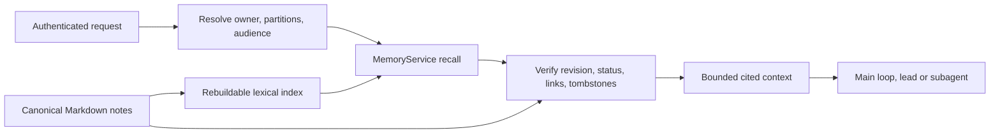

# Proposed native Markdown memory design

**Status: rev 3 (2026-09-23): the owner has answered MD-1…MD-9 (§0); not implemented; awaiting the owner's review of this written design.** Rev 3 applies those answers and the owner's instruction that the old engine be removed completely. Rev 2 applied the [review](05-review.md). Every change traces to evidence in [06a–06d](05-review.md#method), and the revision log at the end lists what moved. Owner decisions **MD-1…MD-9** (§0) are open, and the design is written so that each recommended answer is buildable. See also [the audit](01-code-audit.md), [framework research](02-framework-research.md), [filesystem research](02-filesystem-research.md) and the [implementation plan](04-implementation-plan.md).

## 0. Owner decisions

Rev 1 adopted these silently. They are product decisions, so they went to the owner (project rule: a default that reverses an accepted design or widens a component's job is a decision).

**Answered by the owner on 2026-09-23.** Seven followed the recommendation: MD-1, MD-2, MD-3, MD-4, MD-5, MD-7 and MD-8. Two did not, and the rows below record what was chosen:
- **MD-6: refuse and reset.** Existing data is not converted.
- **MD-9: everything at once.** The GUI ships with the cutover.

**Also decided (owner, 2026-09-23):** "the old memory system with the 768 sql design should be completely removed too, since the app is never released." Nothing of the old engine survives the cutover:
- `memory`, `memory_fts` and `memory_vec float[768]`, and their triggers
- the repositories, models, KB importer and chunker
- the embedder, the indexer and decay
- their config keys, CLI options and docs

There is **no compatibility code** for it: no conversion, no leftover-key warnings, no legacy-cache cleanup command. The factory reset that MD-6 requires already deletes `llm.toml` and restores `daemon.toml`, so no old key can survive to be warned about.

| Id | Question | Recommendation (what rev 2 is written for) | Alternatives and their cost |
|---|---|---|---|
| **MD-1** | Retire embeddings and sqlite-vec with **no** optional semantic path in v1? | **Yes.** Every consumer is memory ([06b](06b-evidence-embedding-inventory.md)). The removal drops 97 of the daemon's 465 dependency packages (96 for `fastembed`, 1 for `sqlite-vec`), the ONNX Runtime library that `ort-sys` fetches at build time (about 67 MB unpacked), and the ~1 GB first-boot model download that the seeded `llm.toml` switches on for every install. | Keep an optional embedder behind a flag. That preserves paraphrase recall but keeps the whole dependency chain in the build. |
| **MD-2** | What does **automatic** learning produce? | **Decide by source role.** A preference or fact stated in the **user's own words** becomes an **active** note with origin `extracted_user`. It has lower authority than an explicit save, never overrides a user-authored note, and appears in a *recently learned* list with one-step undo. Anything inferred from assistant text or tool output stays a **candidate**, outside recall until confirmed. | Rev 1: every extraction is a hidden candidate until reviewed. That is safer, but the assistant stops learning until a review surface ships ([06c](06c-evidence-identity-scope-learning.md) A6). |
| **MD-3** | What happens to the background `USER.md` writer? | **It stops writing learned facts into `USER.md` at cutover.** Learned preferences become memory notes. In the **same** slice, an explicit `USER.md` editor ships (`openalpaca persona edit user` and Settings → Persona), and onboarding completion stops depending on the background writer. `update_persona` stays during bootstrap. | Keep the writer. Two stores then hold learned preferences, and `USER.md` keeps its system-prompt authority for inferred text. |
| **MD-4** | Group chats: rev 1 blocked recall in "group lanes". | **v1 keeps today's lane model.** No group lane exists: a connector lane mixes every DM and group on that platform, and core cannot tell them apart ([06c](06c-evidence-identity-scope-learning.md) A1–A3). Group privacy becomes its own *connector audience* design, covering `USER.md`, transcript, notices and memory together. | Block recall on every connector lane. That also switches recall off in the owner's own DMs. |
| **MD-5** | Which workspace scopes memory? | **The project root found from the request workspace**, by the marker walk memory uses today (`.openalpaca`, else `.git`; `crates/openalpaca_core/src/memory/workspace.rs`). The project store is created lazily on the first project write, as artifacts do. A directory with no marker is global. The daemon's own CWD never selects a project. The CLI sends its CWD on every turn, so rev 1's rule would scatter partitions into arbitrary directories. This **extends ADR-031**, whose CWD-derived `workspace_id` "keeps doing memory scoping". | Rev 1: any explicit request workspace, the CLI's CWD included. An earlier rev-2 draft required an *existing* store, which splits one project's facts before and after its first artifact creates the store (`artifact_write.rs:53-57`). |
| **MD-6** | What happens to existing schema-42 memories (the owner's real store has them)? | **Answer: refuse and reset.** The baseline is re-squashed to 43 without memory tables, and a schema-42 database is refused like 1–41. The owner runs `openalpaca config reset --factory`, which also removes tasks, sessions, usage and `llm.toml` with its API keys. The refusal still works without sqlite-vec ([06d](06d-evidence-vec0-spike.md) Q1). Plan §4 has the refusal text and the switch-over note. | *Recommended, not chosen:* migration 043 in the new build (backup, export to Markdown, stub-`vec0` retirement), keeping every non-memory row. |
| **MD-7** | Is project memory git-ignored? | **Yes, by a self-contained `.gitignore` (`*`) inside `<project>/.openalpaca/memory/`**, written when the partition is created. It works for existing projects and never edits the user's ignore rules. The seeded README text is refreshed. | Today's stated stance: memory is committed with the project. |
| **MD-8** | Fix the current engine's **data-loss** behaviour before the replacement lands? | **Yes, as slice 0**, when the cutover is more than about two weeks away. The fixes: <br>- stop decay pruning <br>- turn off similarity-based replacement for **every** caller, keeping exact-hash dedup only <br>- scope the lead's injection to global when there is no workspace (F1) <br>- stop `config reset` deleting the owner id (a bug) <br>- refuse a database whose schema is newer than the build knows | Wait. Memories in the owner's live store keep being pruned or replaced in the meantime ([05](05-review.md) finding 2). |
| **MD-9** | Which management surfaces ship with the cutover? | **Answer: everything at once.** The API, the CLI and the GUI Memory view (with the Settings → Persona editor) all ship in the cutover. | *Recommended, not chosen:* API and CLI with the cutover, and the GUI in the next slice. |

## 1. Decision and scope

Replace the persistent `MemoryRepository`/vector-memory subsystem with a native Rust `MemoryService`:
- **Markdown files** hold canonical knowledge.
- **One small control snapshot per partition** holds what must not live in editable prose: revisions, origin and tombstones.
- **A separate SQLite FTS5 database** holds disposable search data only.

SQLite stays for conversations, tasks, identities, usage, artifacts and other application state.

The default memory path has no embedding model, reranker, learned tokenizer assets, Python/Node sidecar, model download or network call. Unicode term splitting and substring indexing are ordinary algorithms. Optional extraction uses the existing configured conversation model and its normal cost accounting; it is never required to store, browse, search or delete a note.

This removes the memory model's startup and dependency burden (measured in [06b](06b-evidence-embedding-inventory.md)). Better answer accuracy is a hypothesis to test. That said, today's per-turn recall barely works ([05](05-review.md) finding 1), so the bar is low for the automatic path and real for the tool path. The main quality improvements sought:
- consistent scope enforcement
- explicit corrections
- reliable forgetting (no silent pruning, no similarity replacement)
- source evidence
- predictable context selection

Low-overlap paraphrase and cross-language recall remain the known weakness of lexical search.

Retain conversation compaction, summaries, session logs, task state, skills, `SOUL.md`, `IDENTITY.md` and `USER.md`; they are separate systems. Do not delete the credential `TokenManager`: it manages authentication, not text tokenization. Do not turn retrieved notes into agent instruction files. The KB importer (`memory/kb.rs`, `memory/chunker/`) has **no production caller** since `5ec1db1d` deleted the `/v1/memory*` routes ([06a](06a-evidence-audit-verification.md)), so it is deleted, not ported.

## 2. Fit the existing store

Use `store::content_dir(StoreScope, ContentKind::Memory)`. That content kind already exists, and the home/project READMEs reserve `memory/`. Add helpers to the existing store module rather than joining literal paths throughout core.

```text
<home-store>/memory/owners/<owner-key>/
  MEMORY.md                          generated navigation index; rebuildable
  notes/<uuid>--<short-title>.md     canonical notes (active, archived, candidate)
  .history/<uuid>/<revision>.md      last 5 service-written revisions, current included; never auto-retrieved

<project>/.openalpaca/memory/
  .gitignore                         "*", written with the first partition (MD-7)
  owners/<owner-key>/                ...same shape as the home partition...

<home-store>/state/memory-control/<partition-key>.json
                                     one control snapshot per partition (§6)
<home-store>/state/cache/memory-index-v1.sqlite
                                     disposable catalog, chunks, FTS indexes
```

- `<home-store>` means `store::home_root()`, including `OPENALPACA_HOME_STORE`. No home path is hardcoded.
- `<partition-key>` is `home-<owner-key>` for the home partition, or `proj-<owner-key>-<first 16 hex of sha256(canonical project root)>` for a project partition. A workspace move renames the snapshot along with the rebinding.
- `<owner-key>` is the first 32 hex characters of `sha256(owner_id)`. Owner ids can be arbitrary strings: `link_generate` accepts any `user_id` ([06c](06c-evidence-identity-scope-learning.md) A5). The mapping back to the owner id is recorded in the control snapshot.
- The filename's title part is presentation only. The UUID in the frontmatter is the identity, and a retitle may rename the file in one atomic rename.
- Store helpers exclude `.history`, `.gitignore` and temporary files from note scans.
- Control snapshots sit under machine state, outside the editable content roots. The snapshot binds partition id, owner key and canonical root, and a workspace move updates that binding (§3).

**Why a control snapshot is necessary.** Knowledge lives in Markdown, but three things must survive deletion of the search cache: a forgotten-source tombstone, the service's record of which revision it wrote, and the origin of each note. That is one small JSON file per partition, not a second knowledge database, and memory tools and generic file writes cannot reach it.

Path checks alone do not confine shell or MCP subprocesses running with the same OS identity. Existing unrestricted host execution is equivalent to a trusted administrator for this guarantee, and nothing here claims resistance to the machine owner.

A complete backup or export includes notes **and** the control snapshot. If a partition's snapshot is missing or invalid:
- automatic recall, extraction and replay for that partition are quarantined until `memory doctor --repair` or an explicit import;
- explicit reads still work, and every note is labelled `unverified`;
- empty controls are never silently initialized over existing notes.

A fresh empty partition is initialized atomically. A copied `.md` stays human-readable and can be imported explicitly as unverified reference data. It never inherits identity, authority or forget history.

Do not create one enormous memory file or copy every conversation into a journal. The DB holds the conversation text, and the session log holds only previews ([06c](06c-evidence-identity-scope-learning.md) A11). Start with a shallow `notes/`, and add topic folders only when browsing tests show a need. `MEMORY.md` lists IDs, titles, descriptions and relative links; it is not another authoritative copy of facts.

## 3. Ownership and scope are enforced by the service

Every operation receives a typed `MemoryAccessContext` from the authenticated request or agent runtime: owner identity, the request workspace, allowed operations and channel. These fields never come from LLM tool arguments or a Markdown header. Identity resolution is reused; no parallel owner system is invented.

Rules:

1. **The project partition is the project root found from the request workspace** by the marker walk (`.openalpaca`, else `.git`; MD-5). The store is created lazily on the first project write, as artifacts do. A request with no workspace, or a workspace with no marker above it, reads and writes only the owner's global partition. The daemon's own CWD never selects a project.
2. **With a project store**, reads cover global plus that project for the same owner. Default write scope depends on kind:
   - `preference` defaults to **global**, because a preference stated in a project chat is still the user's;
   - `fact`, `decision`, `procedure` and `reference` default to the **project**;
   - an explicit typed scope enum overrides the default.
3. A project note outranks a global one only for the same explicit `fact_key`, and only where authority permits (§4). Textual similarity never hides a global note, and a lower-authority note never overrides a user-authored one.
4. **Scheduled skills** are global: none has a persisted workspace binding (`apps/openalpacad/src/scheduled_skills.rs:208` sends no workspace). **Follow-ups** replay their stored `workspace_path` through rule 1. **Subagents** inherit a narrowed context and the existing denied-section and tool rules. Fresh searches enforce the same rules as parent-context distillation.
5. **Audience:** v1 keeps today's lane model (MD-4). Memory adds no exposure that `USER.md` and the shared transcript do not already have. Connector audience (DM vs group, non-owner senders) is a separate design, and the iMessage non-owner-as-owner defect is its own task ([05](05-review.md)). Markdown can never set or widen audience.
6. **Unknown fields are rejected.** Tool input carrying `owner_id`, `workspace_id`, an absolute path or trust fields is refused. The tool registry's validator today accepts unknown keys (F2), so the memory tools validate strictly themselves. Every read-by-ID and every mutation re-checks ownership and scope, even after a search.

Note IDs are UUIDs, and citations use partition-relative paths; absolute workspace paths are not baked into records.

**Workspace move.** No move lock exists today ([06c](06c-evidence-identity-scope-learning.md) A7).
- The `PATCH /v1/workspaces` preflight calls `MemoryService::quiesce(partition)`, which refuses the move while a memory write for that project is pending and holds new writes until the rename completes.
- The move then updates the control snapshot's root binding and invalidates the project's catalog entries.
- The raw-SQL re-keying of `memory.scope_id` in `ArtifactStore::rebase_project` goes with the table.

**Resets.**
- A plain `openalpaca config reset` deleting `identity.local_user_id` is a **bug**, fixed in slice 0 (plan §2): config reset must not delete `identity.*`.
- A factory reset deletes the database, so the next boot mints a new owner id with a different owner key. The old partitions survive as files and are listed by `memory doctor` as *orphaned*.
- `openalpaca memory adopt <owner-key>` re-binds an orphaned partition to the current owner. It is a local management command, unavailable to the model and the HTTP API. Nothing is inherited automatically.
- Update the factory-reset preview, which today says memories go with the database, and test it.

## 4. A small, versioned note format

Illustrative v1 file; the UUIDs and ids below are examples, not existing data:

```markdown
---
schema: 1
id: 55e811b6-3220-4758-a47b-034bd1023f38
title: Build and test commands for this workspace
kind: procedure
status: active
fact_key: build.validation
aliases: [checks, validation, 测试, 编译]
tags: [development]
created_at: 2026-09-23T10:00:00Z
updated_at: 2026-09-23T10:00:00Z
observed_at: 2026-09-23T09:55:00Z
valid_from: null
valid_to: null
review_after: null
pinned: false
sources:
  - type: tool_result
    task_id: 7c1e…            # DB ids, never session-log offsets
    observed_at: 2026-09-23T09:55:00Z
supersedes: []
---
# Build and test commands for this workspace

## Knowledge
Run the documented focused checks for the component being changed.

## Evidence and limits
The cited run checked one component. It did not certify the entire application.

## Recheck when
The build configuration or test entry points change.
```

**Fields.**
- Required: schema, UUID, title, kind, status, the created/updated timestamps and a Markdown body.
- Optional: aliases, fact key, tags, effective dates, review date, pin, sources and supersedes.
- `kind` covers fact, preference, decision, procedure, reference and episode.
- `status` covers `active`, `candidate` and `archived`. **Superseded is not a stored status.** It is derived from links (§6), so replacing a note never rewrites the old file.

**Authority** is not in the frontmatter. The partition decides owner and scope. The control snapshot records, per note, the revision the service last wrote and its **origin**:
- `user`: an explicit save or edit through a user-directed surface
- `extracted_user`: extracted from the user's own words (MD-2)
- `extracted_other`: inferred from assistant or tool output, always a candidate
- `imported`: an explicit import of external Markdown
- `external`: the file's bytes no longer match the recorded revision, or the service never wrote the file (dropped in by hand)

Confirming a candidate (`memory_update` action `confirm`, a user-directed surface only) makes it `active` with origin `user`.

Authority ordering: `user` > `extracted_user` > `imported` ≥ `external` > `extracted_other`. An external edit **downgrades** a note to `external` until a service write re-records it. Sources in the note are readable claims, not proof. An LLM-produced confidence number is not calibrated evidence and is not stored as authority.

**Times.** `valid_from`/`valid_to` define a half-open effective-time interval only when evidence supports it; unknown bounds stay null. Current recall excludes notes whose interval has ended, and a historical query evaluates the requested date. `review_after` only requests a recheck; it is never an expiry or deletion.

**Revisions.** A revision is a hash of the file's exact UTF-8 bytes, returned by the service, never embedded in the file.
- `expected_revision` is mandatory for update, archive and forget.
- Untouched Markdown and unknown extension fields are preserved during supported patches.
- Duplicate required keys, invalid timestamps, duplicate IDs and oversized records are rejected with a visible diagnostic. Malformed external files stay on disk, excluded from automatic context, and are never rewritten or deleted during recovery.

**Initial limits** (tune through evaluation):

| Limit | Value |
|---|---|
| Note size | 32 KiB |
| Chunk size | about 1–2 KiB, on heading/paragraph boundaries |
| Combined automatic memory context, pinned notes and wrappers included | 8 KiB |
| Retrieved chunks | at most 8 |
| Explicit tool read response | 32 KiB |

These are byte limits, and the existing budgeting system reserves the headroom. Replace the language-insensitive estimate for this section with a conservative one, and test it on Chinese, emoji and long identifiers.

## 5. Read path: one implementation for every agent



The same `MemoryService::recall` serves `prompt_ctx::MemorySource`, the lead-agent bootstrap and `memory_search`. The lead agent's direct repository query is removed.

The profile is injected **once** per turn. Today it is injected twice on main-loop and skill turns, and the memory section is cached by query text ([05](05-review.md) finding 3). Neither survives the cutover. Retrieved-data trust labels are preserved in all prompts and handoff packages.

Deterministic retrieval steps:

1. **Resolve allowed partitions** before searching (§3). An unknown or unauthorized root fails closed.
2. **Select a few active pinned notes** within a separate sub-budget (initially 2 KiB of the 8 KiB). `MEMORY.md` is optional navigation, not unbounded startup content. Pinned notes are still untrusted reference data.
3. **Search.** Normalize the query and keep exact identifiers and paths alongside Unicode-normalized terms. Search titles, aliases, tags and body with FTS5/BM25 over a **union of terms**. Today's per-turn path requires every word of the whole message and matches almost nothing ([06c](06c-evidence-identity-scope-learning.md) A6). Build query syntax from escaped literal terms (an AST), never from caller-supplied `MATCH` expressions. This removes the F4 class of defect.
4. **Add deterministic candidates** for phrases, exact identifiers and CJK or substrings. An FTS5 trigram companion handles strings of three or more Unicode characters. One- and two-character queries use a bounded scoped substring pass. Return `partial: true` when a scan cap is hit, and do not claim complete Chinese retrieval from `unicode61`.
5. **Filter, then limit.** Union and deduplicate the candidates. Filter owner, scope, kind, status, **derived supersession**, tombstones, audience and effective validity **before** the result limit. Preserve ranking evidence through context assembly, never replacing it with generic importance.
6. **Rank** by exact title/alias hits, lexical relevance, authority (§4), explicit validity and a modest recency tie-break. Pin and test the weights, and do not claim they are optimal. Superseded and archived notes are excluded unless the user explicitly asks for history. Same-key overrides are resolved before budgeting.
7. **Verify.** Reopen the selected files with confined handles, re-hash them, and check status, links and tombstones. Return current excerpts with note ID, relative path, heading, line range, revision, sources, match reason and freshness. A dirty or deleted note is never served from cached text.
8. **Budget and deliver.** Budget whole chunks when possible and mark truncation. Deliver as quoted data in user or tool context, never as a system instruction. A citation resolves to the revision actually read. After eviction or forgetting it reports `revision_unavailable` or `deleted`, and a source whose DB evidence is gone reports `evidence_unavailable`.

The default recall/search path invokes no model. When lexical evidence is weak, the running agent may issue up to two revised searches within its existing loop and cost budget, then abstain or explain the gap. There is no hidden query-expansion agent or neural reranker. Cross-language aliases come from the user or from an already-budgeted write.

**Freshness without a watcher.** Correctness does not depend on filesystem events. The wake watcher cannot add paths after start, and core may not depend on it ([06c](06c-evidence-identity-scope-learning.md) A13). Freshness comes from four sources:
- **Service writes** update the index synchronously, giving read-after-write consistency.
- **Reconciliation** is a bounded stat scan (mtime + size + inode) of the partition's `notes/`. It runs at service start, every 30 s, before management reads, and on `sync`. Changed files are re-hashed and re-indexed.
- **Verification** of every selected file (step 7) stops a stale deletion or edit from being served before reconciliation sees it.
- A missed **new** external file may be absent until the next scan, and freshness is reported.

A `notify` watcher in the daemon is an optional latency improvement, measured before it is added. Cold start opens the index if it is valid and schedules reconciliation on a blocking worker. A missing or corrupt index triggers a rebuild, and search meanwhile serves a bounded scoped file scan with `index_state: rebuilding`.

## 6. Writes, corrections, deletion and recovery

### Write protocol

There is one daemon-owned writer queue per partition. CLI and GUI mutations go through the service. Offline management (`doctor --repair`, `adopt`) takes the store lock and refuses while the daemon runs. File access uses confined no-follow handles and rejects escaping paths, symlinks and junctions, hardlink aliases where enforceable, and hidden or control-file targets. The atomic write builds on `store::write_atomic` (`crates/openalpaca_storage/src/store/mod.rs:754`), hardened with a no-follow open, a file `fsync` and a directory `fsync` where the platform supports it. The artifact store's crash-tested put path (`crates/openalpaca_storage/src/artifacts/`) is the reference.

**Every mutation touches at most one note file.** That keeps recovery to a single pending field instead of an operation log:

| Mutation | Steps (each step atomic) | Recovery at service start |
|---|---|---|
| **create / update / archive** | 1. Snapshot: set `pending = {id, from_rev, to_rev}` <br>2. Write the note (temp, `fsync`, rename; the prior revision is copied to `.history`) <br>3. Snapshot: record `to_rev` and origin, clear `pending` <br>4. Update index and `MEMORY.md` | File equals `to_rev`: finish step 3. <br>File equals `from_rev` or is absent: clear `pending`. <br>Anything else: an external edit raced us. The note becomes `external`, and the service's own revision is still in `.history`, which keeps every service-written revision. |
| **supersede** (replace note A with B) | **Create B** with `supersedes: [A]`, given A's id **and expected revision**. A's revision is checked, not written; a changed A is a conflict. A's file is **not touched**: A is superseded because a qualifying note names it (below). | As for create. |
| **forget** (ids with expected revisions) | 1. Snapshot: append tombstones (id, `supersedes` list, suppressed source ids) <br>2. Delete the note files and their `.history` <br>3. Purge index and navigation | A tombstoned id whose file still exists: delete it. Idempotent. |

**Derived supersession.** A note is superseded when an **active or archived note, or a tombstone**, lists it in `supersedes` and three conditions hold:
- **Same partition.** A link across partitions is ignored.
- **Enough authority.** The superseder's origin must rank **at or above** the target's (§4). A lower-authority link never hides a higher-authority note, so hand-edited frontmatter cannot retire a user's note. Such a link is reported by `doctor` and the GUI as a conflict, and both notes stay active.
- **Not a candidate.** A candidate supersedes nothing until it is confirmed.

Archiving or forgetting a replacement therefore does **not** revive what it replaced, because tombstones keep their `supersedes` lists and their origin rank for exactly this. Restoring an old note is an explicit update that removes the link. Only the single `pending` field needs crash recovery. A multi-note change is expressed as independent single-note mutations whose intermediate states are all valid, never advertised as atomic.

External editors do not honor app locks. The revision check prevents stale overwrites between **service** writers, and an external edit is detected and downgraded (§4). The final race with an arbitrary in-place editor is surfaced as a conflict. It is not claimed to be impossible.

Snapshots are replaced atomically and stay bounded: completed pending fields are cleared, duplicate source-suppression entries are compacted, and a live tombstone is never discarded to meet a size cap. Tests cover a corrupt or truncated snapshot, a missing file, and a crash at each step in the table.

### Promotion and correction

- **Explicit "remember"** writes are synchronous (origin `user`), acknowledged only after durable success.
- **Automatic extraction** follows MD-2. User-stated preferences and facts become active notes with origin `extracted_user`, listed as *recently learned* with undo. Inferences from assistant text or tool output become `candidate`s. Failed or cancelled tasks and assistant-only completion claims never become facts. Extraction is bounded per turn and per run by count as well as cost. The existing "daily" caps are counters since daemon start that never reset and never bind on a $0 model ([06c](06c-evidence-identity-scope-learning.md) A12). It runs cancellably with task attribution, with no fire-and-forget jobs.
- **Deduplication** is exact, within one owner and partition. Similarity can suggest a relation, never prove equivalence or contradiction, and **nothing is replaced by similarity**. A replacement is an explicit supersede with the same `fact_key`, or a user correction.
- **Updating a note** uses its ID and expected revision. Observation time is kept separate from effective time.
- **`USER.md`** (MD-3): it is reserved for deliberately configured identity and interaction instructions. The background profile writer stops writing learned facts into it; they go to memory notes instead.
  - An explicit editor ships in the same slice: `openalpaca persona edit user` and Settings → Persona (MD-9).
  - Onboarding completion stops depending on the background writer.
  - Cutover inventories preferences already extracted into `USER.md` and **proposes** moving them to notes; hand-authored lines are never deleted automatically.
  - A persona instruction that conflicts with a memory note is surfaced for an explicit persona edit, not silently overridden.
  - A forget result names retained persona or transcript copies when known.
- **Decay and automatic pruning of durable knowledge are removed.** `review_after` marks staleness, not permission to delete, and archiving is explicit.

### Forget contract

`memory_forget` takes explicit IDs and expected revisions, never "delete the best lexical match". A natural-language request first searches and selects, and ambiguous matches are resolved before deletion. A clear single target needs no confirmation beyond the user's request and existing tool policy.

Forget removes the canonical notes, their `.history` copies, navigation entries, index rows and any live memory-context cache. It records durable tombstones and suppresses extraction replay for the affected source ids. A note whose `sources` cite a forgotten note is **derived** `source_forgotten` at read time and kept out of automatic recall until it is edited. No other file is rewritten, so the one-file rule holds. **The hard guarantee:** no retrieval or replay resurrects the known records or source ids, including after an index rebuild or a restart that recovers a `pending` write.

**Limit:** tombstones live in the partition's snapshot.
- A **lost or corrupt** snapshot quarantines the partition (§2), so nothing is recalled rather than something resurrected.
- An **older snapshot restored from a backup** lacks tombstones written after that backup, so a restore is an explicit management action whose preview lists the notes it would bring back.

Transcript messages, session logs and external backups are separate data. The forget result states whether they remain and points at their existing deletion controls; it does not claim the memory action erases every copy. Raw source text still visible in the active conversation can still influence an answer, so memory sections are refreshed and the boundary is stated. Semantic re-expression from new evidence cannot be blocked by hashes, and a new explicit user instruction may intentionally reintroduce a fact. Historic sessions are not re-extracted by default. Tombstones store ids and source suppression, never the forgotten plaintext. There is no automatic Git history or cloud sync.

## 7. Tools, API and app surfaces

These are provider-neutral contracts. Familiar names are kept where useful, and old argument formats break cleanly (the app is unreleased).

| Operation | Model/tool input | Result and enforced behavior |
|---|---|---|
| `memory_search` | query, optional kind/scope enum, bounded limit, historical flag | Cited snippets, revision, match reasons, freshness and completeness; active-only by default |
| `memory_read` | note ID, optional expected revision and section | Bounded current Markdown and provenance; the service re-checks access |
| `memory_store` | title, body, kind, optional scope enum, aliases, optional verified source handles | New UUID and revision. No raw path, ownership or trust accepted from the client. |
| `memory_update` | ID, expected revision, structured patch or body, reason; action `edit`, `archive`, `supersede` (the target's id and expected revision) or `confirm` (user-directed surfaces only) | Conflict or a new revision |
| `memory_forget` | IDs with expected revisions | Per-ID status plus the stated evidence and history scope |
| `memory_list` | kind/status, page cursor, bounded scope enum | Metadata; history and candidates only on explicit request |

**Capabilities.**
- `memory_read` covers search, read and list.
- `memory_write` covers store and update.
- `memory_forget` is destructive.
- `memory_manage` covers import, export, adopt, reindex and doctor, and is never granted to the model by default.

Map them through tool annotations, platform classification, the sandbox policy, the default agent allowlists in `config/agents/*.md` (five worker templates grant `memory_read` today) and deny settings. Workers get no write access through a globally available tool. The main conversation keeps its user-directed write capability.

**Surfaces, all shipping with the cutover (MD-9):**
- **API, with the cutover.** Typed `/v1/memories` routes (list, search, read, create, update, forget, `recently-learned`, and management-only `sync`), under the existing bearer auth. Edits use `If-Match` or a revision (409 on conflict), with cursor pagination, capped payloads and escaped Markdown rendering. Regenerate `docs/api/`.
- **CLI, with the cutover.** `openalpaca memory list|search|show|add|edit|confirm|undo|forget|sync|doctor|adopt`, sharing the daemon's semantics. `undo` forgets a *recently learned* note. `doctor --repair` and `adopt` are local-only. Also `openalpaca persona edit user` (MD-3).
- **GUI, with the cutover.** A Memory view and a Settings → Persona `USER.md` editor. The Memory view has a scope selector, search, source evidence, raw Markdown and diff, candidates, *recently learned* with undo, revision-conflict handling and forget. It also shows which notes a response used. No model settings or cache internals appear in the editing flow.

## 8. Module boundaries and cost controls

| Location | Responsibility |
|---|---|
| `openalpaca_storage::memory_files` (new) | Note parse/serialize, confined atomic writes, revisions, control snapshot, recovery, owner keys; no LLM dependencies |
| `openalpaca_storage::memory_index` (new) | Separate cache DB, deterministic chunking, FTS5 `unicode61` + trigram, the literal query builder, reconciliation scan, rebuild |
| `openalpaca_storage::migrations` | The baseline re-squashed to 43 without any memory table, and the 1–42 refusal (plan §4). There is no conversion module. |
| `openalpaca_core::memory::service` (new) | `MemoryAccessContext`, recall, corrections, origin/authority, extraction policy (MD-2), tool-facing API |
| `openalpaca_core::prompt_ctx::sources::memory` | The single bounded injection adapter, consuming service relevance and citations |
| `openalpacad` services / background / routes | Build one service; run the reconciliation timer; the move-quiesce hook; `/v1/memories`. No embedder, no indexer, no decay worker. |

Prefer existing crates over a new framework or crate graph: `uuid`, `sha2`, the store path helpers, `write_atomic`, the artifact store's write discipline, and cost accounting. `notify` stays out of core. No new crate and no new feature is needed. Record the following without logging note bodies:
- search time
- candidate and chunk counts
- index state
- scope
- injection bytes
- dropped-note reasons
- extraction cost and count

## 9. First-release exclusions

The first release has none of these:
- mandatory Git
- remote synchronization
- an embedding fallback
- a graph service
- automatic repository-wide document ingestion
- all-agent autonomous writers
- autonomous folder reorganization
- time-based deletion of durable notes
- a connector-audience model (MD-4, its own design)

Importing an arbitrary Markdown knowledge base is a separate, bounded feature with a visible source snapshot and a re-import policy. The dead KB importer is deleted, not reused.

These exclusions keep the replacement reviewable. Expand only after the evaluation in the plan identifies a concrete deficiency.

## Revision log

- **rev 3 (2026-09-23):** the owner answered MD-1…MD-9.
  - **MD-6 (refuse and reset)** removes the `imported_legacy` origin, the `legacy:` block, `migrate --dry-run` and the `legacy_memory` module.
  - **MD-9 (everything at once)** puts the GUI and the Persona editor in the cutover.
  - **The owner's instruction** removes the old engine completely, with no compatibility code.
- **rev 2 (2026-09-23):** applies [05-review.md](05-review.md).
  - **§0 (new):** owner decisions MD-1…MD-9, which rev 1 had adopted silently.
  - **§2:** control records collapse to one snapshot per partition, with no operation records. Owner key = a hash of the owner id. The project `.gitignore` lives inside the memory directory (MD-7).
  - **§3:** the group-lane rule is replaced by today's lane model plus a separate connector-audience design (MD-4). The workspace rule uses the marker-found project root with lazy store creation (MD-5, extending ADR-031). Preferences default to global. A move-quiesce hook replaces the nonexistent move lock. Resets become the config-reset bug fix, orphan listing and an explicit `adopt`.
  - **§4:** superseded becomes derived, not stored. Authority moves from frontmatter to the snapshot's origin field, with an explicit ordering. Sources cite DB ids, not session logs.
  - **§5:** union-of-terms retrieval, the per-turn defect called out, one profile injection, and freshness by reconciliation scan instead of a required watcher.
  - **§6:** every mutation touches at most one note file, with a single `pending` field for recovery, and forget is tombstone-first. Nothing is replaced by similarity. `USER.md` handling follows MD-3.
  - **§7:** capabilities named and surfaces staged (MD-9).
  - **§8:** module for migration 043 added; `notify` kept out of core.
  - The KB importer is deleted as dead code.
  - **After a consistency review** ([05](05-review.md#consistency-review-of-rev-2)): <br>- MD-5 uses the marker-found project root, with lazy store creation <br>- scheduled skills are global <br>- derived supersession requires the same partition and at least equal authority <br>- supersede checks the target's revision <br>- dependents of a forgotten note are derived, not rewritten <br>- `.history` keeps service-written revisions <br>- the partition key and the `confirm`/`undo` operations are defined <br>- the snapshot-loss limit is stated <br>- `migrate --dry-run` ships with the cutover <br>- `rusqlite`/`uuid` features named <br>- MD-8 covers every caller and the newer-schema guard
- **rev 1 (2026-09-23):** initial proposal.
